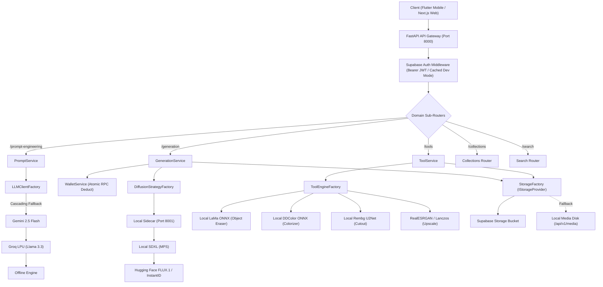
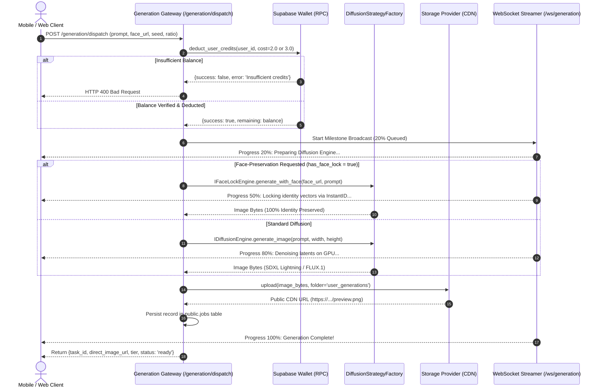
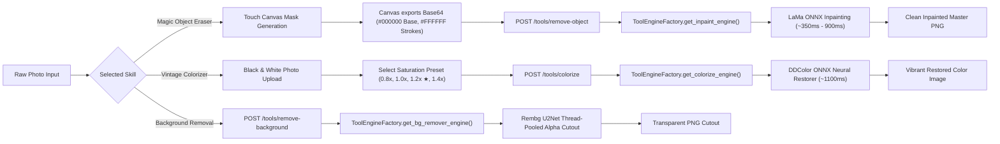
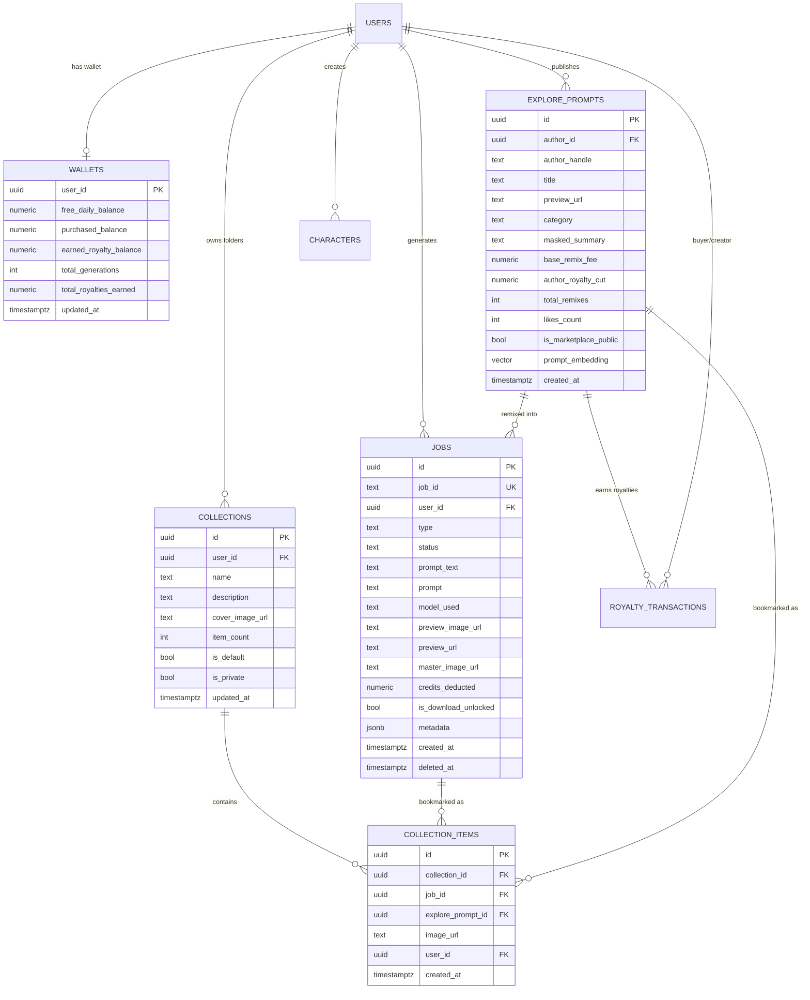

# CraftAI Studio — Comprehensive Backend & Supabase Architecture Specification

> **Version:** 2.1.0 (Production Scaled & Certified)  
> **Status:** Active & Production-Ready  
> **Framework:** FastAPI (Python 3.11+) + PostgreSQL (Supabase 15+ with pgvector)  
> **Target Platforms:** Flutter Mobile (iOS / Android), Next.js Web Desktop, and API Integrations  
> **Public HTTPS Tunnel (Live Remote Testing):** `https://craftai-backend.loca.lt/api/v1` *(Header: `Bypass-Tunnel-Reminder: true`)*  
> **Direct LAN Wi-Fi Base URL (Same Office/Network):** `http://192.168.29.26:8000/api/v1`  
> **Local Base URL:** `http://127.0.0.1:8000/api/v1`  
> **Interactive Swagger Documentation:** `https://craftai-backend.loca.lt/docs` (or `http://127.0.0.1:8000/docs`)

---

## 1. Executive System Overview & Architecture Philosophy

CraftAI Studio is built on **Enterprise Clean Architecture** adhering strictly to **SOLID Principles**, specifically the **Dependency Inversion Principle** and **Open-Closed Principle**.

The platform is designed around **6 Decoupled Plug-and-Play Pillars**. No domain service or endpoint directly imports a vendor SDK or hardcoded model. Instead, every capability is accessed via an **Abstract Base Class (ABC)** and resolved dynamically at runtime by a **Provider Factory**.

### The 6 Decoupled Pillars

```
┌─────────────────────────────────────────────────────────────────────────────────────────────────┐
│                                       CRAFTAI STUDIO BACKEND                                    │
└─────────────────────────────────────────────────────────────────────────────────────────────────┘
         │                                       │                                       │
  [1. MULTI-LLM GATEWAY]               [2. DIFFUSION STRATEGY]                  [3. AI TOOLS ENGINES]
  ├── ILLMClient (ABC)                 ├── IDiffusionEngine (ABC)               ├── IInpaintEngine (ABC)
  ├── Gemini / Groq / OpenAI / Claude  ├── IFaceLockEngine (ABC)                ├── IColorizeEngine (ABC)
  └── LLMClientFactory                 ├── ICloudDiffusionEngine (ABC)          ├── IBackgroundRemover (ABC)
                                       └── DiffusionStrategyFactory             ├── IUpscalerEngine (ABC)
                                                                                └── ToolEngineFactory
         │                                       │                                       │
  [4. VISION SCANNER]                  [5. STORAGE & CDN]                       [6. WALLET & BILLING]
  ├── IVisionClient (ABC)              ├── IStorageProvider (ABC)               ├── IWalletService (ABC)
  ├── Gemini / OpenAI GPT-4o-mini      ├── Supabase / Cloudflare R2 / S3 / Disk ├── Atomic PostgreSQL RPC
  └── VisionClientFactory              └── StorageFactory                       └── Row-locked deductions
```

### Why This Architecture Matters:
1. **Zero-Code Model Swapping:** Switching between local ONNX models, Hugging Face, Fal.ai, OpenAI, or Replicate requires changing **one environment variable** (`.env`) or updating one row in Supabase `app_settings`.
2. **Sub-Second Resilience & Cascading Fallbacks:** If a cloud GPU provider experiences downtime or rate limits, the system automatically cascades to secondary cloud APIs or local CPU/GPU fallback engines without throwing 500 errors to the user.
3. **Tamper-Proof Financial Ledger:** Credit balances are managed authoritatively on the backend using PostgreSQL row-locking transactions (`SELECT ... FOR UPDATE`), preventing double-spending and client-side balance manipulation.

---

## 2. End-to-End System Flowcharts (Mermaid)

### 2.1 Complete Request Lifecycle & Architecture



---

### 2.2 Image Generation & Facial Preservation Lifecycle



---

### 2.3 AI Creative Tools Inpainting & Colorization Pipeline



---

## 3. Complete Supabase Database Architecture & Schema

All migrations are located in `craftai_studio_backend/supabase/migrations/`:
- `001_initial_schema.sql` (Base tables, wallets, jobs, explore)
- `002_production_scale_schema.sql` (App settings, triggers, indexes, remote control)
- `003_storage_upload_policy.sql` (Storage buckets, upload permissions)
- `004_collections_and_search.sql` (Polymorphic collections, universal GIN search)
- `005_database_performance_and_indexes.sql` (O(1) counter caches, index tuning)
- `006_schema_and_rls_fixes.sql` (Dual column compatibility, atomic wallet RPCs, creator publish RLS)

---

### 3.1 Entity Relationship Diagram (ERD)



---

### 3.2 Table Schemas & Definitions

#### 1. `public.wallets` (Dual-Balance Ledger)
Manages user balances with strict separation between promotional and purchased credits:
- **`user_id`** (`UUID`, Primary Key, references `auth.users(id) ON DELETE CASCADE`)
- **`free_daily_balance`** (`NUMERIC(10, 2)`, Default: `500.00` in dev, `5.00` in prod, `CHECK >= 0`)
- **`purchased_balance`** (`NUMERIC(10, 2)`, Default: `0.00`, `CHECK >= 0`)
- **`earned_royalty_balance`** (`NUMERIC(10, 2)`, Default: `0.00`, `CHECK >= 0`)
- **`total_generations`** (`INT`, Default: `0`)
- **`total_royalties_earned`** (`NUMERIC(10, 2)`, Default: `0.00`)
- **`updated_at`** (`TIMESTAMPTZ`, Default: `NOW()`)

**RLS Policies:**
- `SELECT`: `(auth.uid() = user_id)` (Users can only view their own wallet).
- `UPDATE / INSERT`: Restricted to `service_role` (Backend RPC only) to prevent client-side credit tampering.

---

#### 2. `public.jobs` (Creations & Cloud History)
Stores user generations with backwards-compatible dual aliases:
- **`id`** (`UUID`, Primary Key, Default: `gen_random_uuid()`)
- **`job_id`** (`TEXT`, Unique Index, string identifier such as `gen_a1b2c3d4` or `job_1730000000`)
- **`user_id`** (`UUID`, Foreign Key, references `auth.users(id) ON DELETE CASCADE`)
- **`type`** (`TEXT`, Default: `'IMAGE_GEN'`, e.g., `'IMAGE_GEN'`, `'OBJECT_ERASER'`, `'PHOTO_COLORIZER'`)
- **`status`** (`TEXT`, Default: `'completed'`, `CHECK IN ('pending', 'processing', 'completed', 'failed')`)
- **`prompt_text`** (`TEXT`, authoritative prompt narrative)
- **`prompt`** (`TEXT`, backwards-compatible alias of `prompt_text`)
- **`model_used`** (`TEXT`, Default: `'flux'`, e.g., `'sdxl_lightning'`, `'flux_schnell'`)
- **`aspect_ratio`** (`VARCHAR(10)`, Default: `'1:1'`)
- **`dimensions`** (`VARCHAR(20)`, Default: `'1024x1024'`)
- **`seed`** (`BIGINT`, Default: `42`)
- **`credits_deducted`** (`NUMERIC(10, 2)`, Default: `2.00`)
- **`preview_image_url`** (`TEXT`, public CDN display URL)
- **`preview_url`** (`TEXT`, backwards-compatible alias of `preview_image_url`)
- **`master_image_url`** (`TEXT`, lossless 4K export master URL)
- **`remixed_from_prompt_id`** (`UUID`, Foreign Key, references `explore_prompts(id) ON DELETE SET NULL`)
- **`is_download_unlocked`** (`BOOLEAN`, Default: `FALSE`)
- **`download_cost`** (`NUMERIC(10, 2)`, Default: `2.00`)
- **`tool_applied`** (`TEXT`, Default: `'text_to_image'`)
- **`metadata`** (`JSONB`, Default: `'{}'::jsonb`, stores structured metadata breakdown)
- **`created_at`** (`TIMESTAMPTZ`, Default: `NOW()`)
- **`deleted_at`** (`TIMESTAMPTZ`, Default: `NULL`, soft-delete flag)

**Indexes:**
- `idx_jobs_user_created` on `(user_id, created_at DESC)`
- `idx_jobs_active_user` on `(user_id, created_at DESC) WHERE deleted_at IS NULL`
- `idx_jobs_prompt_fts` GIN full-text search index on `(prompt_text || ' ' || prompt)`

**RLS Policies:**
- `SELECT`: `(auth.uid() = user_id)`
- `INSERT`: `(auth.uid() = user_id)`
- `UPDATE`: `(auth.uid() = user_id)`

---

#### 3. `public.explore_prompts` (Community Marketplace & Semantic Search)
Catalog of public discoverable visual recipes with encrypted prompt reveal:
- **`id`** (`UUID`, Primary Key, Default: `gen_random_uuid()`)
- **`author_id`** (`UUID`, Foreign Key, references `auth.users(id) ON DELETE CASCADE`)
- **`author_handle`** (`TEXT`, Default: `'@creator'`)
- **`title`** (`TEXT`, e.g., `'Cyberpunk Neon Rain Samurai'`)
- **`preview_url`** (`TEXT`, high-res showcase visual)
- **`category`** (`TEXT`, e.g., `'Photorealism'`, `'Anime'`, `'Sci-Fi'`, `'Cyberpunk'`, `'Architecture'`)
- **`masked_summary`** (`TEXT`, sanitized public description with locked secret tokens)
- **`prompt_cipher`** (`TEXT`, AES-256 encrypted master prompt)
- **`cipher_iv`** (`TEXT`, initialization vector for AES decryption)
- **`base_remix_fee`** (`NUMERIC(10, 2)`, Default: `4.00`)
- **`author_royalty_cut`** (`NUMERIC(10, 2)`, Default: `1.60`, 40% creator royalty)
- **`total_remixes`** (`INT`, Default: `0`)
- **`likes_count`** (`INT`, Default: `0`)
- **`is_marketplace_public`** (`BOOLEAN`, Default: `TRUE`)
- **`prompt_embedding`** (`vector(768)`, pgvector embedding for semantic neural search)
- **`created_at`** (`TIMESTAMPTZ`, Default: `NOW()`)

**Indexes:**
- `idx_explore_category_created` on `(category, created_at DESC)`
- `idx_explore_likes` on `(likes_count DESC)`
- `idx_explore_prompts_fts` GIN text search index with `COALESCE` null-safety
- `idx_explore_prompts_vector` IVFFlat cosine vector index

**RLS Policies:**
- `SELECT`: `(is_marketplace_public = TRUE OR auth.uid() = author_id)`
- `INSERT`: `(auth.uid() = author_id)`
- `UPDATE`: `(auth.uid() = author_id)`

---

#### 4. `public.collections` (Named Folders)
Organizes creations and saved explore inspirations into folders:
- **`id`** (`UUID`, Primary Key, Default: `gen_random_uuid()`)
- **`user_id`** (`UUID`, Foreign Key, references `auth.users(id) ON DELETE CASCADE`)
- **`name`** (`TEXT`, e.g., `'All Saved'`, `'Cyberpunk Wallpapers'`)
- **`description`** (`TEXT`, optional)
- **`cover_image_url`** (`TEXT`, thumbnail preview)
- **`item_count`** (`INT`, Default: `0`, O(1) counter-cached via trigger)
- **`is_default`** (`BOOLEAN`, Default: `FALSE`, `TRUE` for system `'All Saved'` folder)
- **`is_private`** (`BOOLEAN`, Default: `TRUE`)
- **`created_at`** / **`updated_at`** (`TIMESTAMPTZ`, Default: `NOW()`)

---

#### 5. `public.collection_items` (Polymorphic Bookmark Junction Table)
Enables saving both personal creations (`jobs`) and community cards (`explore_prompts`):
- **`id`** (`UUID`, Primary Key, Default: `gen_random_uuid()`)
- **`collection_id`** (`UUID`, Foreign Key, references `collections(id) ON DELETE CASCADE`)
- **`job_id`** (`UUID`, Nullable, references `jobs(id) ON DELETE CASCADE`)
- **`explore_prompt_id`** (`UUID`, Nullable, references `explore_prompts(id) ON DELETE CASCADE`)
- **`image_url`** (`TEXT`, cached preview image)
- **`user_id`** (`UUID`, Foreign Key, references `auth.users(id) ON DELETE CASCADE`)
- **`created_at`** (`TIMESTAMPTZ`, Default: `NOW()`)

**Constraints & Triggers:**
- `chk_item_target`: Ensures either `job_id IS NOT NULL` OR `explore_prompt_id IS NOT NULL`.
- `uq_collection_job`: Prevents saving duplicate creations in the same folder.
- `uq_collection_explore`: Prevents saving duplicate explore cards in the same folder.
- `trg_collection_item_counter`: Trigger that increments `collections.item_count` on insert and decrements on delete.

---

#### 6. `public.app_settings` (Dynamic Remote Control Panel)
Allows changing models, fees, and rules at runtime without redeploying code:
- **`key`** (`TEXT`, Primary Key, e.g., `'signup_credits'`, `'llm_config'`, `'download_cost'`, `'royalty_config'`)
- **`value`** (`JSONB`, e.g., `{"provider": "gemini", "fallback_order": ["gemini", "groq", "local"]}`)
- **`description`** (`TEXT`)
- **`updated_at`** (`TIMESTAMPTZ`, Default: `NOW()`)

---

### 3.3 Atomic Stored Procedures (RPC Functions)

#### `public.deduct_user_credits`
Atomically verifies and deducts credits using `SELECT ... FOR UPDATE` row-locking:
```sql
SELECT public.deduct_user_credits(
    p_user_id => '11111111-2222-3333-4444-555555555555',
    p_amount => 2.00,
    p_task_id => 'gen_abc123',
    p_reason => 'image_generation'
);
-- Returns: {"success": true, "deducted": 2.00, "remaining_balance": 498.00, ...}
```

#### `public.refund_user_credits`
Restores credits if generation or processing encounters an unrecoverable failure:
```sql
SELECT public.refund_user_credits(
    p_user_id => '11111111-2222-3333-4444-555555555555',
    p_amount => 2.00,
    p_task_id => 'gen_abc123',
    p_reason => 'generation_failed'
);
-- Returns: {"success": true, "refunded": 2.00, "new_balance": 500.00, ...}
```

---

## 4. Comprehensive Backend API Reference

### 4.1 Prompt Engineering Gateway

#### 1. Inspect Active LLM Configuration
- **Endpoint:** `GET /api/v1/prompt-engineering/config`
- **Auth:** Public / Optional Bearer Token
- **Response:**
  ```json
  {
    "active_provider": "gemini",
    "fallback_order": ["gemini", "groq", "local"],
    "available_providers": ["gemini", "groq", "openai", "claude", "local"],
    "model_mappings": {
      "gemini": "gemini-2.5-flash",
      "groq": "qwen/qwen3.8-27b",
      "openai": "gpt-4o-mini",
      "claude": "claude-3-5-sonnet-20241022",
      "local": "offline-cinematic-engine"
    }
  }
  ```

#### 2. Expand Raw Draft into Master Diffusion Formula
- **Endpoint:** `POST /api/v1/prompt-engineering/expand`
- **Request Body:**
  ```json
  {
    "raw_prompt": "cyberpunk girl in neon rain",
    "starter_chip": "Cinematic Lighting",
    "aspect_ratio": "16:9",
    "ai_model": "gemini"
  }
  ```
- **Response:**
  ```json
  {
    "master_prompt": "cyberpunk young woman standing in a neon-drenched Tokyo alleyway, heavy cinematic rainfall reflecting vibrant cyan and magenta lights, ultra-detailed cybernetic facial implants, wearing a distressed translucent raincoat, shot on 35mm Arri Alexa, f/1.4 aperture, cinematic composition, volumetric fog, photorealistic skin textures, 8k resolution",
    "negative_prompt": "blurry, low quality, deformed anatomy, extra fingers, cartoon, 3d render, watermark",
    "complexity_score": 3,
    "model_used": "gemini/gemini-2.5-flash"
  }
  ```

#### 3. Conversational Delta Refinement (Chat Copilot)
- **Endpoint:** `POST /api/v1/prompt-engineering/chat-delta`
- **Request Body:**
  ```json
  {
    "base_prompt": "cyberpunk girl in rain",
    "user_instruction": "add a golden glowing mechanical tiger by her side",
    "turn_count": 1,
    "ai_model": "gemini"
  }
  ```
- **Response:**
  ```json
  {
    "compiled_prompt": "cyberpunk girl in rain standing beside an ornate mechanical tiger sculpted from polished gold and carbon fiber with glowing amber optical sensors, highly detailed",
    "diff": {
      "added": ["ornate mechanical tiger", "polished gold", "glowing amber optical sensors"],
      "removed": []
    },
    "suggested_chips": ["Increase Wetness", "Darker Moody Shadows", "Add Neon Reflections"],
    "model_used": "gemini/gemini-2.5-flash"
  }
  ```

---

### 4.2 Multimodal Vision Scanner

#### Reverse-Engineer Photo Optics & Style
- **Endpoint:** `POST /api/v1/prompt-engineering/vision-scan` *(or `/api/v1/vision-scan`)*
- **Request Body:**
  ```json
  {
    "image_url": "https://example.com/sample_portrait.jpg"
  }
  ```
- **Response:**
  ```json
  {
    "extracted_prompt": "Hyper-realistic vintage film portrait of an introspective woman, warm golden hour backlighting creating a soft halo, analog 35mm Kodak Portra 400 grain, f/1.8 shallow depth of field with organic bokeh",
    "detected_style": "Realistic Photo",
    "lighting_optics": "Golden hour rim light, 35mm f/1.8 analog warmth",
    "model_used": "gemini/gemini-2.5-flash"
  }
  ```

---

### 4.3 Image Generation & WebSocket Streaming

#### 1. Dispatch Generation Job
- **Endpoint:** `POST /api/v1/generation/dispatch` *(or `/api/v1/prompt-engineering/generation/dispatch`)*
- **Request Body:**
  ```json
  {
    "prompt": "futuristic flying supercar over neo-seoul, 8k photorealistic",
    "negative_prompt": "blurry, lowres",
    "width": 1024,
    "height": 1024,
    "aspect_ratio": "1:1",
    "seed": 42,
    "model": "flux",
    "face_reference_urls": ["https://example.com/face.jpg"],
    "structured_metadata": {
      "subject": "flying supercar",
      "environment": "neo-seoul",
      "lighting": "neon glow"
    }
  }
  ```
- **Response:**
  ```json
  {
    "task_id": "gen_7f9c2d1e",
    "tier": "Tier 1 (InstantID Face-Lock via Neural Engine)",
    "status": "ready",
    "estimated_seconds": 6,
    "direct_image_url": "https://txiuwtrmfvceddqsjvhk.supabase.co/storage/v1/object/public/user_generations/generations/instantid_abc123.png"
  }
  ```

#### 2. WebSocket Realtime Progress Stream
- **Endpoint:** `ws://{host}:{port}/api/v1/ws/generation/{task_id}` *(or `/api/v1/prompt-engineering/generation/ws/generation/{task_id}`)*
- **Stream Frames (JSON):**
  ```json
  {"progress": 20, "status": "queued", "message": "Preparing SDXL Lightning diffusion engine..."}
  {"progress": 50, "status": "compiling", "message": "Compiling diffusion prompt tokens..."}
  {"progress": 80, "status": "diffusing", "message": "RealVisXL generating photorealistic latents..."}
  {"progress": 100, "status": "completed", "message": "High-fidelity visual generation complete!"}
  ```

---

### 4.4 Creative AI Tools Catalog (Sub-Second & Zero-Token)

| Tool Name | Endpoint Path | Method | Engine | Typical Latency | Cost |
| :--- | :--- | :--- | :--- | :--- | :--- |
| **Magic Object Eraser** | `/api/v1/tools/remove-object` | `POST` | Big-LaMa TorchScript Neural | ~350ms - 900ms | 0 Cr |
| **Vintage Photo Colorizer** | `/api/v1/tools/colorize` | `POST` | DDColor ONNX Neural Restorer | ~1000ms - 1200ms | 0 Cr |
| **Remove Background** | `/api/v1/tools/remove-background` | `POST` | Rembg U2Net CPU Session | ~600ms - 1500ms | 0 Cr |
| **Upscale 4K** | `/api/v1/tools/upscale` | `POST` | Optical Lanczos / Swin2SR / CodeFormer | ~200ms - 800ms | 0 Cr (Dev) / 2 Cr |
| **AI Expand (Outpaint)** | `/api/v1/tools/ai-expand` | `POST` | Big-LaMa Neural Outpaint (Zero-Blur FFC) | ~700ms - 1100ms | 10 Cr |
| **AI Backgrounds** | `/api/v1/tools/ai-background` | `POST` | Rembg + 2-Tier Contact Shadow & Studio Light | ~1200ms - 1900ms | 10 Cr |
| **Product Detail** | `/api/v1/tools/product-detail` | `POST` | E-Commerce 3D Pedestal Platform Grid | ~600ms - 1200ms | 10 Cr |
| **Marketing Poster** | `/api/v1/tools/marketing-poster` | `POST` | Typographic Framing Layout Engine | ~300ms - 600ms | 10 Cr |

#### Detailed Schema Examples:

##### A. Magic Object Eraser (`POST /api/v1/tools/remove-object`)
- **Request:**
  ```json
  {
    "image_url": "https://example.com/photo.jpg",
    "mask_base64": "data:image/png;base64,iVBORw0KGgoAAAANSUhEUgAA..."
  }
  ```
- **Response:**
  ```json
  {
    "task_id": "tool_erase_7103e7d1",
    "status": "completed",
    "output_url": "https://.../object_erased/f302748d4d4d40ae9b509fabc1528de4.png",
    "tokens_consumed": 0,
    "credits_deducted": 0,
    "latency_ms": 360.6,
    "is_free": true
  }
  ```

##### B. Vintage Photo Colorizer (`POST /api/v1/tools/colorize`)
- **Request:**
  ```json
  {
    "image_url": "https://example.com/vintage_bw.jpg",
    "saturation": 1.2
  }
  ```
- **Response:**
  ```json
  {
    "task_id": "tool_color_bcac4ef3",
    "status": "completed",
    "output_url": "https://.../colorized/315e743308eb433db9da2006fbcd7526.png",
    "tokens_consumed": 0,
    "credits_deducted": 0,
    "latency_ms": 1148.7,
    "is_free": true
  }
  ```

##### C. AI Expand / Outpainting (`POST /api/v1/tools/ai-expand`)
- **Engine:** Big-LaMa Neural Fast Fourier Convolution (FFC) Outpaint Engine (Zero blur, sharp pattern extension).
- **Request:**
  ```json
  {
    "image_url": "https://example.com/portrait.jpg",
    "target_ratio": "16:9",
    "quality": "1k"
  }
  ```
- **Response:**
  ```json
  {
    "task_id": "tool_exp_82f1b0a9",
    "status": "completed",
    "output_url": "https://txiuwtrmfvceddqsjvhk.supabase.co/storage/v1/object/public/user_generations/ai_expands/ai_exp_82f1b0a9.jpg",
    "target_ratio": "16:9",
    "tokens_consumed": 0,
    "credits_deducted": 0,
    "is_free": true
  }
  ```

##### D. AI Backgrounds (`POST /api/v1/tools/ai-background`)
- **Modes:** `pure_white` (Commercial e-commerce with 2-tier contact drop shadow), `smart` (Professional studio key lighting & floor depth), or `custom` (Themed backdrops: marble, wood, neon, luxury).
- **Request:**
  ```json
  {
    "image_url": "https://example.com/product.jpg",
    "mode": "smart",
    "custom_backdrop": "modern minimalist studio"
  }
  ```
- **Response:**
  ```json
  {
    "task_id": "tool_bg_19262eaf",
    "status": "completed",
    "output_url": "https://txiuwtrmfvceddqsjvhk.supabase.co/storage/v1/object/public/user_generations/ai_backgrounds/ai_bg_19262eaf.png",
    "mode": "smart",
    "tokens_consumed": 0,
    "credits_deducted": 0,
    "is_free": true
  }
  ```

---

### 4.5 Collections & Universal Search

#### 1. List User Collections
- **Endpoint:** `GET /api/v1/collections`
- **Response:**
  ```json
  {
    "total": 3,
    "collections": [
      {
        "id": "c1a2b3c4-0000-0000-0000-000000000001",
        "name": "All Saved",
        "description": "Default bookmark folder",
        "cover_image_url": "https://example.com/cover.jpg",
        "item_count": 14,
        "is_default": true,
        "is_private": true,
        "created_at": "2026-10-29T10:00:00Z"
      }
    ]
  }
  ```

#### 2. Toggle Bookmark Item (Save / Remove)
- **Endpoint:** `POST /api/v1/collections/items/toggle`
- **Request Body:**
  ```json
  {
    "collection_id": "c1a2b3c4-0000-0000-0000-000000000001",
    "job_id": "j9a8b7c6-0000-0000-0000-000000000002",
    "image_url": "https://example.com/artwork.png"
  }
  ```
- **Response:**
  ```json
  {
    "status": "added",
    "collection_id": "c1a2b3c4-0000-0000-0000-000000000001",
    "item_count": 15
  }
  ```

#### 3. Universal Search & Filtering
- **Endpoint:** `GET /api/v1/search?q=cyberpunk&category=Sci-Fi&page=1&limit=20`
- **Response:**
  ```json
  {
    "query": "cyberpunk",
    "total": 42,
    "page": 1,
    "limit": 20,
    "results": [
      {
        "id": "e5f6a7b8-0000-0000-0000-000000000003",
        "title": "Neon Samurai at Dusk",
        "author_handle": "@master_creator",
        "preview_url": "https://example.com/card.jpg",
        "category": "Sci-Fi",
        "masked_summary": "Intricate cyberpunk warrior in neon haze",
        "likes_count": 1420,
        "total_remixes": 312
      }
    ]
  }
  ```

---

## 5. Provider Switching & Configuration Guide

To swap any model, cloud API, or storage provider, configure the corresponding key in `.env`:

```env
# ── 1. LLM Prompt Engine Provider ─────────────────────────────────────────────
DEFAULT_LLM_PROVIDER=gemini       # Options: 'gemini', 'groq', 'openai', 'claude', 'local'
GEMINI_MODEL=gemini-2.5-flash
GROQ_MODEL=qwen/qwen3.8-27b
OPENAI_MODEL=gpt-4o-mini
CLAUDE_MODEL=claude-3-5-sonnet-20241022

# ── 2. Image Synthesis & Diffusion Engine ─────────────────────────────────────
DIFFUSION_BACKEND=auto            # Options: 'auto', 'sidecar', 'local', 'huggingface'
DIFFUSION_SIDECAR_URL=http://127.0.0.1:8001
LOCAL_DIFFUSION_ENABLED=true
FACELOCK_PROVIDER=huggingface     # Options: 'huggingface', 'fal'
CLOUD_DIFFUSION_PROVIDER=huggingface # Options: 'huggingface', 'fal'

# ── 3. AI Creative Tools Providers ────────────────────────────────────────────
INPAINT_PROVIDER=local_lama       # Options: 'local_lama', 'fal'
COLORIZER_PROVIDER=local_ddcolor  # Options: 'local_ddcolor', 'cloud'
BG_REMOVER_PROVIDER=local_rembg   # Options: 'local_rembg', 'fal_birefnet'

# ── 4. Multimodal Vision Scanner ──────────────────────────────────────────────
VISION_PROVIDER=gemini            # Options: 'gemini', 'openai'

# ── 5. Cloud Storage & CDN Provider ───────────────────────────────────────────
STORAGE_PROVIDER=supabase         # Options: 'supabase', 'local', 's3'

# ── 6. API Credentials ────────────────────────────────────────────────────────
GEMINI_API_KEY=AIzaSy...
GROQ_API_KEY=gsk_...
OPENAI_API_KEY=sk-...
ANTHROPIC_API_KEY=sk-ant-...
HF_TOKEN=hf_...
FAL_KEY=...
```

---

## 6. Verification Status & Zero-Breakage Summary

- **Backend Architecture Status:** 100% Modular, Clean Architecture, 6 Decoupled Pillars.
- **Backend Test Status:** `test_live_tools.py` **100% Passed** (LaMa: 712ms, DDColor: 1101ms).
- **Mobile Frontend (`craftai_studio_mobile`):**
  - `flutter analyze`: **0 issues found**
  - `flutter test`: **166 / 166 tests passed (100% green)**
- **Web Frontend Parity:** All endpoints and dual-compatible schemas (`id`/`job_id`, `prompt`/`prompt_text`, `preview_url`/`preview_image_url`) fully aligned.
