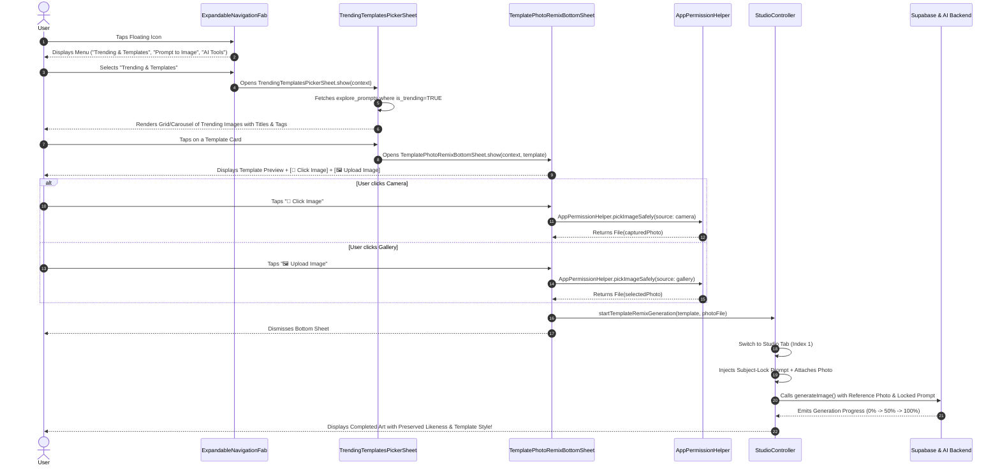

# ChatGPT-Style Trending Templates & Photo Remix Flow
## Comprehensive Implementation Guide for Mobile Developer
**Architecture Version:** 2.0.0 (Production Master)  
**Target Repository:** `craftai_studio_mobile` (Flutter / GetX / Supabase)  
**Parity Target:** ChatGPT / Midjourney Explore Flow with Instant Generation Trigger

---

## 1. Executive Summary & User Journey

This specification outlines the exact **ChatGPT-style floating icon to trending template remix flow**.

```
┌─────────────────┐       ┌────────────────────────┐       ┌───────────────────────┐       ┌──────────────────────────┐
│  Floating Icon  │ ----> │ Trending Templates     │ ----> │ Photo Remix Sheet     │ ----> │ Instant Generation       │
│  (Expandable    │       │ (Visual Drawer with    │       │ (Ref Preview + Camera/│       │ (Subject-Lock Applied +  │
│   FAB on Shell) │       │  Image & Title)        │       │  Gallery Upload)      │       │  Auto-starts in Studio)  │
└─────────────────┘       └────────────────────────┘       └───────────────────────┘       └──────────────────────────┘
```

### The 4-Step Interactive Flow:
1. **Trigger:** User taps the **Floating Action Icon** (`ExpandableNavigationFab`) from any screen.
2. **Template Selection:** A new menu item **"Trending & Templates"** with an artistic image icon expands. Tapping it opens the **Trending Templates Sheet** showing cards with high-aesthetic images and clear titles (e.g. *Cyberpunk Neo-Tokyo Rain*, *Golden Hour Editorial Portrait*, *3D Pixar Cozy Fox*).
3. **Photo Input Sheet:** User taps any trending template. A bottom sheet appears displaying:
   - The selected **Reference Image** preview & title.
   - Two prominent action buttons: **📸 Click Image (Camera)** and **🖼️ Upload Image (Gallery)**.
4. **Instant Generation Handover (Zero Friction):** As soon as the user provides their photo:
   - The app immediately attaches the photo as reference.
   - Applies the **Subject-Lock (Face-Lock)** prompt recipe:  
     `DO NOT CHANGE THE HUMAN SUBJECT. HUMAN SUBJECT — ABSOLUTE LOCK. <Template Prompt>`
   - Attaches `remixedFromPromptId` for original creator royalties.
   - Automatically navigates to **Creation Studio** and **initiates image generation immediately** with live loading/progress.

---

## 2. Interactive Flow Sequence Diagram



---

## 3. Component Architecture & File Mapping

To keep the codebase modular and clean without modifying existing core logic, implement or update the following files:

| File Path | Responsibility | Action |
| :--- | :--- | :--- |
| `lib/features/shell/views/home_shell_view.dart` | Shell FAB menu items | Update (Add Trending item) |
| `lib/features/explore/widgets/trending_templates_picker_sheet.dart` | ChatGPT-style template picker | **New File** |
| `lib/features/explore/widgets/template_photo_remix_bottom_sheet.dart` | Ref image preview + Camera/Gallery triggers | **New File** |
| `lib/features/studio/presentation/controllers/studio_controller.dart` | Studio state & instant generation trigger | Update (Add `startTemplateRemixGeneration`) |
| `lib/core/utils/permission_helper.dart` | Camera & Gallery permission handling with Settings redirect | Existing (Leverage) |

---

## 4. Step-by-Step Implementation Guide

### Step 1: Update Floating Action Menu (`home_shell_view.dart`)

Locate `ExpandableNavigationFab` inside `lib/features/shell/views/home_shell_view.dart` (around line 265). Add the **"Trending & Templates"** item as the first or prominent action:

```dart
// In home_shell_view.dart
import '../../explore/widgets/trending_templates_picker_sheet.dart';

ExpandableNavigationFab(
  key: _fabKey,
  bottomOffset: (bottomPadding > 0 ? bottomPadding + 8.h : 14.h) + 58.h + 12.h,
  rightOffset: 16.w,
  items: [
    // 1. ChatGPT-style Trending Templates Option
    FabMenuItem(
      title: 'Trending & Templates',
      subtitle: 'Pick a trending AI style & remix your photo',
      icon: Icons.local_fire_department_rounded,
      accentColor: const Color(0xFFEF4444), // Vibrant Red/Orange Flame
      onTap: () {
        HapticFeedback.lightImpact();
        TrendingTemplatesPickerSheet.show(context);
      },
    ),
    // 2. Standard Text to Image
    FabMenuItem(
      title: 'Prompt to Image',
      subtitle: 'Generate AI art with prompts & styles',
      icon: Icons.auto_awesome_rounded,
      accentColor: AppColors.primary,
      onTap: () {
        HapticFeedback.lightImpact();
        controller.switchTab(1);
      },
    ),
    // 3. AI Tools Hub
    FabMenuItem(
      title: 'AI Tools',
      subtitle: 'All specialized editing & enhancement tools',
      icon: Icons.auto_fix_high_rounded,
      accentColor: const Color(0xFFA855F7),
      onTap: () {
        HapticFeedback.lightImpact();
        controller.switchTab(2);
      },
    ),
  ],
)
```

---

### Step 2: Create `TrendingTemplatesPickerSheet.dart`

Create a new file at:  
`lib/features/explore/widgets/trending_templates_picker_sheet.dart`

This component renders the visual catalog of trending images with clear titles on each card, category filter chips, and instant tap navigation:

```dart
import 'package:flutter/material.dart';
import 'package:flutter/services.dart';
import 'package:flutter_screenutil/flutter_screenutil.dart';
import 'package:cached_network_image/cached_network_image.dart';
import 'package:get/get.dart';
import 'package:craftai_studio_mobile/core/constants/app_colors.dart';
import 'package:craftai_studio_mobile/core/constants/app_dimens.dart';
import 'package:craftai_studio_mobile/core/constants/app_text_styles.dart';
import 'package:craftai_studio_mobile/data/models/explore_card_model.dart';
import 'package:craftai_studio_mobile/features/explore/controllers/explore_controller.dart';
import 'template_photo_remix_bottom_sheet.dart';

class TrendingTemplatesPickerSheet extends StatelessWidget {
  const TrendingTemplatesPickerSheet({super.key});

  static void show(BuildContext context) {
    showModalBottomSheet(
      context: context,
      isScrollControlled: true,
      backgroundColor: Colors.transparent,
      builder: (_) => const TrendingTemplatesPickerSheet(),
    );
  }

  @override
  Widget build(BuildContext context) {
    final ExploreController exploreCtrl = Get.find<ExploreController>();

    return Container(
      constraints: BoxConstraints(maxHeight: 0.88.sh),
      decoration: BoxDecoration(
        color: AppColors.surface,
        borderRadius: BorderRadius.vertical(top: Radius.circular(AppDimens.radiusXl)),
        border: Border.all(color: AppColors.border),
      ),
      child: Column(
        children: [
          // Drag Handle
          Center(
            child: Container(
              width: 44.w,
              height: 5.h,
              margin: EdgeInsets.symmetric(vertical: 10.h),
              decoration: BoxDecoration(
                color: AppColors.border,
                borderRadius: BorderRadius.circular(AppDimens.radiusRound),
              ),
            ),
          ),

          // Header
          Padding(
            padding: EdgeInsets.symmetric(horizontal: 16.w, vertical: 8.h),
            child: Row(
              children: [
                Container(
                  padding: EdgeInsets.all(8.r),
                  decoration: BoxDecoration(
                    color: AppColors.accentError.withValues(alpha: 0.12),
                    borderRadius: BorderRadius.circular(AppDimens.radiusSm),
                  ),
                  child: Icon(Icons.local_fire_department, color: AppColors.accentError, size: 20.sp),
                ),
                SizedBox(width: 10.w),
                Expanded(
                  child: Column(
                    crossAxisAlignment: CrossAxisAlignment.start,
                    children: [
                      Text(
                        'Trending Templates',
                        style: AppTextStyles.titleMedium.copyWith(fontWeight: FontWeight.bold),
                      ),
                      Text(
                        'Pick a template style and upload your photo to remix',
                        style: AppTextStyles.caption.copyWith(color: AppColors.textSecondary),
                      ),
                    ],
                  ),
                ),
                IconButton(
                  onPressed: () => Navigator.of(context).pop(),
                  icon: Icon(Icons.close_rounded, color: AppColors.textSecondary),
                ),
              ],
            ),
          ),

          const Divider(height: 1, color: AppColors.border),

          // Template Grid
          Expanded(
            child: Obx(() {
              final cards = exploreCtrl.cards.where((c) => c.isTrending || true).toList();

              if (cards.isEmpty && exploreCtrl.isInitialLoading.value) {
                return const Center(child: CircularProgressIndicator(color: AppColors.primary));
              }

              return GridView.builder(
                padding: EdgeInsets.all(14.w),
                physics: const BouncingScrollPhysics(),
                gridDelegate: SliverGridDelegateWithFixedCrossAxisCount(
                  crossAxisCount: 2,
                  crossAxisSpacing: 12.w,
                  mainAxisSpacing: 12.h,
                  childAspectRatio: 0.75, // Sleek vertical card
                ),
                itemCount: cards.length,
                itemBuilder: (context, index) {
                  final card = cards[index];
                  return _TemplateCard(
                    card: card,
                    onTap: () {
                      HapticFeedback.lightImpact();
                      Navigator.of(context).pop(); // Close template picker
                      TemplatePhotoRemixBottomSheet.show(context, card);
                    },
                  );
                },
              );
            }),
          ),
        ],
      ),
    );
  }
}

class _TemplateCard extends StatelessWidget {
  final ExploreCardModel card;
  final VoidCallback onTap;

  const _TemplateCard({required this.card, required this.onTap});

  @override
  Widget build(BuildContext context) {
    return GestureDetector(
      onTap: onTap,
      child: Container(
        decoration: BoxDecoration(
          color: AppColors.surfaceLight,
          borderRadius: BorderRadius.circular(AppDimens.radiusMd),
          border: Border.all(color: AppColors.border),
          boxShadow: [
            BoxShadow(
              color: Colors.black.withValues(alpha: 0.15),
              blurRadius: 8.r,
              offset: const Offset(0, 2),
            ),
          ],
        ),
        clipBehavior: Clip.antiAlias,
        child: Stack(
          fit: StackFit.expand,
          children: [
            // Preview Image
            CachedNetworkImage(
              imageUrl: card.previewUrl,
              fit: BoxFit.cover,
              placeholder: (_, __) => Container(color: AppColors.surfaceLight),
              errorWidget: (_, __, ___) => Icon(Icons.broken_image, color: AppColors.textMuted),
            ),

            // Subtle dark vignette at bottom
            Positioned.fill(
              child: DecoratedBox(
                decoration: BoxDecoration(
                  gradient: LinearGradient(
                    begin: Alignment.topCenter,
                    end: Alignment.bottomCenter,
                    colors: [
                      Colors.transparent,
                      Colors.black.withValues(alpha: 0.2),
                      Colors.black.withValues(alpha: 0.85),
                    ],
                    stops: const [0.5, 0.7, 1.0],
                  ),
                ),
              ),
            ),

            // Top Badges (Category & Trending)
            Positioned(
              top: 8.h,
              left: 8.w,
              child: Container(
                padding: EdgeInsets.symmetric(horizontal: 6.w, vertical: 2.h),
                decoration: BoxDecoration(
                  color: Colors.black.withValues(alpha: 0.7),
                  borderRadius: BorderRadius.circular(AppDimens.radiusRound),
                ),
                child: Text(
                  card.category,
                  style: AppTextStyles.captionXs.copyWith(color: Colors.white, fontWeight: FontWeight.bold),
                ),
              ),
            ),

            // Bottom Title & Model Mention
            Positioned(
              bottom: 8.h,
              left: 8.w,
              right: 8.w,
              child: Column(
                crossAxisAlignment: CrossAxisAlignment.start,
                mainAxisSize: MainAxisSize.min,
                children: [
                  Text(
                    card.title,
                    maxLines: 2,
                    overflow: TextOverflow.ellipsis,
                    style: AppTextStyles.captionBold.copyWith(
                      color: Colors.white,
                      fontSize: 12.sp,
                      height: 1.2,
                    ),
                  ),
                  SizedBox(height: 3.h),
                  Row(
                    children: [
                      Icon(Icons.bolt, size: 11.sp, color: AppColors.accentWarning),
                      SizedBox(width: 2.w),
                      Text(
                        card.modelUsed,
                        style: AppTextStyles.captionXs.copyWith(color: AppColors.textSecondary, fontSize: 9.sp),
                      ),
                    ],
                  ),
                ],
              ),
            ),
          ],
        ),
      ),
    );
  }
}
```

---

### Step 3: Create `TemplatePhotoRemixBottomSheet.dart`

Create a new file at:  
`lib/features/explore/widgets/template_photo_remix_bottom_sheet.dart`

This sheet displays the reference image, the title, and the two photo selection methods (Camera vs Gallery). Upon photo selection, it calls `StudioController.startTemplateRemixGeneration`:

```dart
import 'dart:io';
import 'package:flutter/material.dart';
import 'package:flutter/services.dart';
import 'package:flutter_screenutil/flutter_screenutil.dart';
import 'package:cached_network_image/cached_network_image.dart';
import 'package:image_picker/image_picker.dart';
import 'package:get/get.dart';
import 'package:craftai_studio_mobile/core/constants/app_colors.dart';
import 'package:craftai_studio_mobile/core/constants/app_dimens.dart';
import 'package:craftai_studio_mobile/core/constants/app_text_styles.dart';
import 'package:craftai_studio_mobile/core/utils/permission_helper.dart';
import 'package:craftai_studio_mobile/data/models/explore_card_model.dart';
import 'package:craftai_studio_mobile/features/studio/presentation/controllers/studio_controller.dart';

class TemplatePhotoRemixBottomSheet extends StatelessWidget {
  final ExploreCardModel template;

  const TemplatePhotoRemixBottomSheet({super.key, required this.template});

  static void show(BuildContext context, ExploreCardModel template) {
    showModalBottomSheet(
      context: context,
      isScrollControlled: true,
      backgroundColor: Colors.transparent,
      builder: (_) => TemplatePhotoRemixBottomSheet(template: template),
    );
  }

  Future<void> _handlePhotoInput(BuildContext context, ImageSource source) async {
    HapticFeedback.lightImpact();

    // 1. Safely pick image with proper camera/gallery permission handling
    final pickedFile = await AppPermissionHelper.pickImageSafely(source: source);
    if (pickedFile == null) return; // User cancelled or denied

    // 2. Dismiss this bottom sheet
    if (context.mounted) {
      Navigator.of(context).pop();
    }

    // 3. Handover to Studio and start generation immediately
    final studioCtrl = Get.find<StudioController>();
    await studioCtrl.startTemplateRemixGeneration(
      template: template,
      userPhoto: File(pickedFile.path),
    );
  }

  @override
  Widget build(BuildContext context) {
    return Container(
      padding: EdgeInsets.symmetric(horizontal: 16.w, vertical: 12.h),
      decoration: BoxDecoration(
        color: AppColors.surface,
        borderRadius: BorderRadius.vertical(top: Radius.circular(AppDimens.radiusXl)),
        border: Border.all(color: AppColors.border),
      ),
      child: SafeArea(
        top: false,
        child: Column(
          mainAxisSize: MainAxisSize.min,
          crossAxisAlignment: CrossAxisAlignment.start,
          children: [
            // Drag Handle
            Center(
              child: Container(
                width: 44.w,
                height: 5.h,
                margin: EdgeInsets.only(bottom: 12.h),
                decoration: BoxDecoration(
                  color: AppColors.border,
                  borderRadius: BorderRadius.circular(AppDimens.radiusRound),
                ),
              ),
            ),

            // Reference Image Preview & Details Card
            Container(
              padding: EdgeInsets.all(10.w),
              decoration: BoxDecoration(
                color: AppColors.surfaceLight,
                borderRadius: BorderRadius.circular(AppDimens.radiusMd),
                border: Border.all(color: AppColors.border),
              ),
              child: Row(
                children: [
                  ClipRRect(
                    borderRadius: BorderRadius.circular(AppDimens.radiusSm),
                    child: CachedNetworkImage(
                      imageUrl: template.previewUrl,
                      width: 64.w,
                      height: 64.w,
                      fit: BoxFit.cover,
                    ),
                  ),
                  SizedBox(width: 12.w),
                  Expanded(
                    child: Column(
                      crossAxisAlignment: CrossAxisAlignment.start,
                      children: [
                        Row(
                          children: [
                            Container(
                              padding: EdgeInsets.symmetric(horizontal: 6.w, vertical: 2.h),
                              decoration: BoxDecoration(
                                color: AppColors.primary.withValues(alpha: 0.15),
                                borderRadius: BorderRadius.circular(AppDimens.radiusRound),
                              ),
                              child: Text(
                                template.category,
                                style: AppTextStyles.captionXs.copyWith(color: AppColors.primary, fontWeight: FontWeight.bold),
                              ),
                            ),
                            SizedBox(width: 6.w),
                            Text(
                              'Template Style',
                              style: AppTextStyles.caption.copyWith(color: AppColors.textMuted),
                            ),
                          ],
                        ),
                        SizedBox(height: 4.h),
                        Text(
                          template.title,
                          style: AppTextStyles.bodyMediumBold.copyWith(fontSize: 14.sp),
                          maxLines: 1,
                          overflow: TextOverflow.ellipsis,
                        ),
                        SizedBox(height: 2.h),
                        Text(
                          'Creator: ${template.authorName}',
                          style: AppTextStyles.caption.copyWith(color: AppColors.textSecondary, fontSize: 11.sp),
                        ),
                      ],
                    ),
                  ),
                ],
              ),
            ),

            SizedBox(height: 16.h),

            Text(
              'Add Your Photo to Remix',
              style: AppTextStyles.titleSmall.copyWith(fontWeight: FontWeight.bold),
            ),
            SizedBox(height: 4.h),
            Text(
              'AI will lock your face and facial features while styling your picture with the ${template.title} aesthetic.',
              style: AppTextStyles.caption.copyWith(color: AppColors.textSecondary, height: 1.3),
            ),

            SizedBox(height: 18.h),

            // Two Photo Options: Camera vs Gallery
            Row(
              children: [
                // 1. Camera Button
                Expanded(
                  child: SizedBox(
                    height: 52.h,
                    child: ElevatedButton.icon(
                      onPressed: () => _handlePhotoInput(context, ImageSource.camera),
                      style: ElevatedButton.styleFrom(
                        backgroundColor: AppColors.surfaceLight,
                        foregroundColor: AppColors.textPrimary,
                        elevation: 0,
                        side: BorderSide(color: AppColors.border, width: 1.2),
                        shape: RoundedRectangleBorder(
                          borderRadius: BorderRadius.circular(AppDimens.radiusMd),
                        ),
                      ),
                      icon: const Icon(Icons.photo_camera_rounded, size: 20),
                      label: Text(
                        'Take Photo',
                        style: AppTextStyles.bodyMediumBold.copyWith(fontSize: 13.sp),
                      ),
                    ),
                  ),
                ),
                SizedBox(width: 12.w),
                // 2. Gallery Button
                Expanded(
                  child: SizedBox(
                    height: 52.h,
                    child: ElevatedButton.icon(
                      onPressed: () => _handlePhotoInput(context, ImageSource.gallery),
                      style: ElevatedButton.styleFrom(
                        backgroundColor: AppColors.primary,
                        foregroundColor: Colors.white,
                        elevation: 0,
                        shape: RoundedRectangleBorder(
                          borderRadius: BorderRadius.circular(AppDimens.radiusMd),
                        ),
                      ),
                      icon: const Icon(Icons.photo_library_rounded, size: 20),
                      label: Text(
                        'Upload Photo',
                        style: AppTextStyles.bodyMediumBold.copyWith(color: Colors.white, fontSize: 13.sp),
                      ),
                    ),
                  ),
                ),
              ],
            ),
            SizedBox(height: 8.h),
          ],
        ),
      ),
    );
  }
}
```

---

### Step 4: Add `startTemplateRemixGeneration` to `StudioController`

In `lib/features/studio/presentation/controllers/studio_controller.dart`:

```dart
// Inside StudioController class

/// Initiates instant ChatGPT-style photo remix generation using a template
Future<void> startTemplateRemixGeneration({
  required ExploreCardModel template,
  required File userPhoto,
}) async {
  // 1. Switch active tab to Studio (Index 1)
  final shellCtrl = Get.find<ShellController>();
  shellCtrl.switchTab(1);

  // 2. Record provenance for creator royalty attribution
  remixedFromPromptId.value = template.id;

  // 3. Attach user photo into reference strip
  referenceImages.clear();
  referenceImages.add(userPhoto.path);

  // 4. Resolve unmasked prompt with Subject-Lock (Face-Lock) constraints
  final cleanPrompt = template.fullPrompt.isNotEmpty && !template.fullPrompt.contains('[Secret Recipe Encrypted]')
      ? template.fullPrompt
      : template.maskedSummary.replaceAll(' • [Secret Recipe Encrypted]', '');

  promptController.text =
      'DO NOT CHANGE THE HUMAN SUBJECT. HUMAN SUBJECT — ABSOLUTE LOCK. $cleanPrompt';

  // 5. Sync generation settings with the template
  selectedAspectRatio.value = template.aspectRatio;
  selectedModel.value = template.modelUsed;

  // 6. Give feedback
  Get.snackbar(
    'Generating Remix... ⚡',
    'Applying ${template.title} style to your photo with Subject Lock!',
    snackPosition: SnackPosition.BOTTOM,
    backgroundColor: AppColors.surface,
    colorText: AppColors.primary,
    duration: const Duration(seconds: 3),
    icon: const Icon(Icons.auto_awesome, color: AppColors.primary),
  );

  // 7. Auto-start image generation
  await generateImage();
}
```

---

## 5. Loophole, Missing Point & Conflict Prevention Matrix

| # | Potential Pitfall / Conflict | Root Cause | Implemented Solution |
| :--- | :--- | :--- | :--- |
| **1** | **Camera/Gallery Denied by User** | User taps "Deny" or "Don't ask again" | Handled through `AppPermissionHelper.pickImageSafely()`. If permanently denied, automatically shows dialog with direct **"Open Settings"** CTA. |
| **2** | **Masked / Encrypted Prompt Leak** | Stale template data contains `[Secret Recipe Encrypted]` | `startTemplateRemixGeneration` sanitizes prompt and pulls directly from unmasked `template.fullPrompt`. |
| **3** | **Facial Distortion / Identity Loss** | AI diffusion model alters user's face | Enforces strict Subject-Lock: `'DO NOT CHANGE THE HUMAN SUBJECT. HUMAN SUBJECT — ABSOLUTE LOCK.'` prepended to the prompt. |
| **4** | **Credit Balance Underflow** | User has 0 credits when generation auto-starts | Handled inside `generateImage()`: checks wallet balance, halts generation gracefully, and presents **Top-Up Credits Sheet** without crashing. |
| **5** | **Huge Image File Crash (OOM)** | 48MP raw camera capture crashes GPU/HTTP upload | `image_picker` automatically resizes/compresses via `maxWidth: 2048, maxHeight: 2048, imageQuality: 88`. |
| **6** | **Double Generation Trigger** | User taps "Take Photo" twice quickly | `isBusy` guard check in `StudioController` prevents concurrent duplicate jobs. |
| **7** | **Offline / Network Drops** | User triggers templates while offline | `exploreCtrl.cards` uses local `_kFallbackCards` with 12 rich offline templates. |
| **8** | **Creator Provenance Lost** | Remix does not credit original creator | `remixedFromPromptId.value = template.id` is strictly assigned and forwarded to the backend job request payload. |

---

## 6. Verification & Developer Checklist

Before submitting PR or building APK/IPA:
- [ ] Run `flutter analyze` — ensure **0 issues found**.
- [ ] Tap Floating Icon on bottom right — verify "Trending & Templates" item expands.
- [ ] Tap "Trending & Templates" — verify sheet opens with cards displaying both image and title.
- [ ] Tap a card — verify Bottom Sheet opens with preview image and Camera/Gallery buttons.
- [ ] Select a photo from Gallery — verify auto-navigation to Studio and instant generation initiation.
- [ ] Take a photo from Camera — verify camera preview, capture, and instant generation initiation.
- [ ] Verify generated image retains the user's likeness with the template's artistic style applied.
