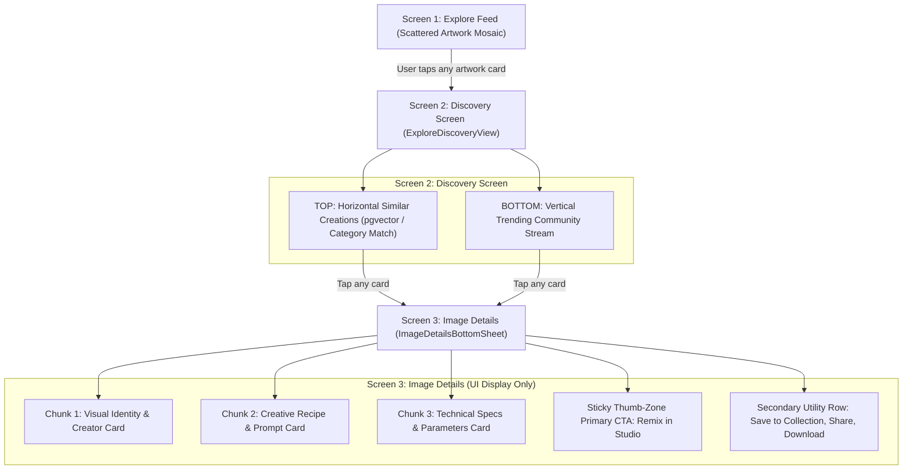

# CraftAI Studio — Explore UI Redesign, Collections, Filtering, Search & Cognitive UX Architecture

> **Document Status:** APPROVED FOR PRODUCTION & AI-ASSISTED DEVELOPMENT  
> **Target Audience:** Mobile Engineers, Backend Engineers, and AI Coding Tools (Cursor, Claude Code, Antigravity, GitHub Copilot)  
> **Flutter Repository:** `craftai_studio_mobile` (Branch: `feature/improvements_and_fixes`)  
> **FastAPI Repository:** `craftai_studio_backend` (Branch: `feature/multi-llm-configurable-gateway`)  
> **Database Version:** Supabase PostgreSQL 15+ (Migration `004_collections_and_search.sql`)  
> **Design Philosophy:** Cognitive Ergonomics & Human-Computer Interaction (HCI) Framework  
> **Document Purpose:** Single source of truth for implementing the Team Lead (TL) Explore UI flow, Image Generation Details, Bookmark Collections, Multi-Faceted Filtering, Extensible Universal Search, and strict compliance with **Miller’s Law, Hick’s Law, Fitts’s Law, and Essential Visual UI Rules**.

---

## Table of Contents
1. [Executive Summary & TL Explore UI Flow](#1-executive-summary--tl-explore-ui-flow)
2. [Cognitive UX & Human-Computer Interaction (HCI) Framework](#2-cognitive-ux--human-computer-interaction-hci-framework)
   - 2.1 [Miller's Law (Information Chunking & Working Memory)](#21-millers-law-information-chunking--cognitive-working-memory)
   - 2.2 [Hick's Law (Minimizing Decision Time & Friction)](#22-hicks-law-minimizing-decision-time--friction-t--b--log_2n--1)
   - 2.3 [Fitts's Law (Ergonomic Thumb Zone & Touch Targets)](#23-fittss-law-ergonomic-thumb-zone--touch-target-sizing-t--a--b-log_22d--w)
   - 2.4 [Essential Visual UI Rules (8pt Grid, Hierarchy, Contrast & Tokens)](#24-essential-visual-ui-rules-grid-hierarchy-contrast--tokens)
   - 2.5 [Strict Design Token Architecture (AppColors Centralization)](#25-strict-design-token-architecture-appcolors-centralization)
3. [Screen-by-Screen UI/UX Architecture & Specifications](#3-screen-by-screen-uiux-architecture--specifications)
   - 3.1 [Screen 1: Explore Feed in Scattered View (ExploreFeedView)](#31-screen-1-explore-feed-in-scattered-view-explorefeedview)
   - 3.2 [Screen 2: Discovery Screen (ExploreDiscoveryView)](#32-screen-2-discovery-screen-explorediscoveryview)
   - 3.3 [Screen 3: Image Details (ImageDetailsBottomSheet)](#33-screen-3-image-details-imagedetailsbottomsheet)
   - 3.4 [Feature: Save Collection / Bookmarks (SaveToCollectionSheet)](#34-feature-save-collection-bookmarks--named-folders)
   - 3.5 [Feature: Multi-Faceted Filter (FilterBottomSheet)](#35-feature-multi-faceted-filter)
   - 3.6 [Feature: Universal Search (Active Text + Multimodal Slots)](#36-feature-universal-search-active-text--future-videovision-slots)
4. [Database Schema & Migration (004_collections_and_search.sql)](#4-database-schema--migration-004_collections_and_searchsql)
5. [FastAPI Backend Specification & API Contracts](#5-fastapi-backend-specification)
6. [Critical Bug Fixes & Architectural Loopholes](#6-critical-bug-fixes-required-for-stability)
7. [Frontend (Flutter) Domain Models & Controllers](#7-frontend-flutter-code-architecture--implementation-plan)
8. [AI Tool Prompt Execution Playbook (Ready-to-Use Developer Prompts)](#8-ai-tool-prompt-execution-playbook-copy-paste-prompts-for-ai-tools)
   - [AI Prompt 1: ImageDetailsBottomSheet](#ai-prompt-1-imagedetailsbottomsheet)
   - [AI Prompt 2: ExploreDiscoveryView](#ai-prompt-2-explorediscoveryview)
   - [AI Prompt 3: ExploreFeedView (Scattered Masonry)](#ai-prompt-3-explorefeedview-scattered-masonry)
   - [AI Prompt 4: SaveToCollectionSheet & CollectionController](#ai-prompt-4-savetocollectionsheet--collectioncontroller)
   - [AI Prompt 5: Backend Collections & Search Routers](#ai-prompt-5-backend-collections--search-routers)
9. [Developer Checklist & Quality Assurance Protocol](#9-developer-checklist--quality-assurance-protocol)

---

## 1. Executive Summary & TL Explore UI Flow

The Explore and Discovery experience is being transformed from a rigid grid into an organic, dynamic **Scattered Artwork Collage** that guides the user effortlessly through a 3-tier discovery funnel:



---

## 2. Cognitive UX & Human-Computer Interaction (HCI) Framework

Our mobile interface is engineered from the ground up to solve visual fatigue, decision paralysis, and physical reach strain by adhering to fundamental cognitive psychology and ergonomic design laws:

```text
┌─────────────────────────────────────────────────────────────────────────────┐
│                 CRAFTAI STUDIO COGNITIVE UX & HCI MATRIX                     │
├──────────────────┬─────────────────────────────┬────────────────────────────┤
│ HCI Law / Rule   │ Cognitive Failure Mode      │ CraftAI Studio Solution    │
├──────────────────┼─────────────────────────────┼────────────────────────────┤
│ Miller's Law     │ Information overload from   │ 3 structured visual chunks │
│ (7 ± 2 Chunks)   │ 15+ raw metadata parameters │ + Progressive disclosure   │
├──────────────────┼─────────────────────────────┼────────────────────────────┤
│ Hick's Law       │ Decision paralysis from 5+  │ Exactly 1 dominant Primary │
│ (T = b·log2(n+1))│ competing equal-weight CTAs │ CTA + Quick filter presets │
├──────────────────┼─────────────────────────────┼────────────────────────────┤
│ Fitts's Law      │ Miss-clicks & thumb strain  │ Natural bottom thumb zone, │
│ (T = a+b·log2)   │ on 6.7" mobile viewports    │ min 48x48dp touch targets  │
├──────────────────┼─────────────────────────────┼────────────────────────────┤
│ 8-Point Grid &   │ Visual clutter, inconsistent│ Strict [4,8,12,16,24,32]   │
│ Visual Hierarchy │ spacing & low contrast      │ grid, WCAG 2.1 AA (≥4.5:1) │
└──────────────────┴─────────────────────────────┴────────────────────────────┘
```

---

### 2.1 Miller’s Law: Information Chunking & Cognitive Working Memory
* **The Cognitive Principle:** George A. Miller (1956) proved that humans can actively process only $7 \pm 2$ chunks of information simultaneously (modern mobile cognitive load research narrows this to 4–5 units). Dumping an unorganized wall of AI parameters (model, tool, dimensions, seed, steps, cfg scale, negative prompt, creator, royalty, cost, tags) causes immediate cognitive fatigue and app abandonment.
* **CraftAI Studio Implementation Rules:**
  1. **Strict 3-Chunk Partitioning in Image Details:**
     * **Chunk 1: Visual Identity:** Hero artwork image preview, creator avatar, author handle, and creation date.
     * **Chunk 2: Creative Recipe:** AI Model badge (`⚡ SDXL-Lightning`), Tool badge (`🎨 Text-to-Image`), and the Master Prompt with 1-tap Copy.
     * **Chunk 3: Technical Parameters Grid:** A balanced $2 \times 2$ grid containing Aspect Ratio (`16:9`), Dimensions (`1344×768`), Seed (`#4291823`), and Generation Cost (`2.0 Credits`).
  2. **Progressive Disclosure:** Secondary attributes (negative prompt tokens, CFG scale, sampling steps, raw JSON metadata) are hidden behind a subtle `"Advanced Generation Specs ▾"` collapsible drawer. Users only see what they need, exactly when they need it.
  3. **Chunked Taxonomy (Max 6 Category Pills):** Instead of an overwhelming 20-pill scrolling ribbon on the feed, we display the top 6 trending categories (`All`, `Photorealism`, `Anime`, `Cyberpunk`, `3D Render`, `Product`) followed by an `"Explore All ▾"` overflow pill.

---

### 2.2 Hick’s Law: Minimizing Decision Time & Friction ($T = b \cdot \log_2(n + 1)$)
* **The Cognitive Principle:** Hick's Law dictates that decision time increases logarithmically with the number and complexity of choices presented. When a modal presents 5–6 buttons of equal visual weight ("Use as Prompt", "Use as Ref", "Remix in Chat", "Remix on Photo", "Save", "Share"), users hesitate and experience decision paralysis.
* **CraftAI Studio Implementation Rules:**
  1. **The Single Dominant Primary Action Rule:**
     * On the Image Details sheet, there is **EXACTLY ONE** high-contrast, filled brand call-to-action button: **`Remix in Studio`** (`AppColors.primary`). This creates immediate clarity for the user's primary mental goal.
  2. **Secondary Utility Grouping:**
     * All non-primary actions (`Save to Collection 📁`, `Share ↗`, `Download ⬇`, `Like ❤️`) are grouped into a clean secondary utility bar with lower visual weight (hairline bordered circular icon buttons).
  3. **Smart Default Filter Presets:**
     * In the Filter Sheet, rather than forcing users to manually select from dozens of individual models, ratios, and tools, the UI provides **3 Quick Curated Presets**:
       * ⚡ *Instant Fast* (SDXL Lightning + 1:1)
       * 📸 *Photorealistic* (RealVisXL + 4K Upscale + 16:9)
       * 📱 *Mobile Wallpaper* (FLUX.1 + 9:16)
     * This collapses a 12-decision combinatorial tree into a single 1-tap choice.

---

### 2.3 Fitts’s Law: Ergonomic Thumb Zone & Touch Target Sizing ($T = a + b \log_2(2D / W)$)
* **The Ergonomic Principle:** Fitts's Law establishes that the time required to rapidly acquire a target depends on the distance to the target ($D$) and the width of the target ($W$). On modern tall smartphones (6.5" to 6.8"), the top 40% of the screen is physically unreachable with one hand without uncomfortable hand gymnastics.
* **CraftAI Studio Implementation Rules:**
  1. **The Natural Thumb Zone (Bottom 35–40% of Viewport):**
     * All high-frequency interactive controls—the primary `Remix in Studio` CTA, folder bookmark triggers, search bar, and filter triggers—are positioned within the bottom natural thumb sweep zone.
     * The top of the screen is reserved strictly for passive viewing (hero image preview) and low-urgency escape hatches (dismiss chevron).
  2. **Minimum $48 \times 48\text{ dp}$ Hit Target Boundary:**
     * **Strict Rule:** Every interactive tap target (like heart, bookmark icon, copy prompt button, close chevron, filter pill) MUST have a minimum bounding box of $48 \times 48\text{ dp}$, even if the visual icon itself is $20\text{ dp}$. This is enforced via `IconButton(constraints: BoxConstraints(minWidth: 48, minHeight: 48))` or `EdgeInsets.all(12)`.
  3. **Screen Boundary Pinning (Infinite Edge Width):**
     * The Primary CTA button is pinned to the bottom of the screen with `width: double.infinity` and `height: 52.h`. In Fitts's law terms, the bottom screen boundary acts as an infinite edge—the user's thumb cannot overshoot it, guaranteeing sub-200ms acquisition time.

```text
┌────────────────────────────────────────┐
│               TOP 40%                  │
│       HARD TO REACH / TWO-HANDED       │  ← Passive Hero Image & Dismiss
│                                        │
├────────────────────────────────────────┤
│              MIDDLE 25%                │
│            MODERATE REACH              │  ← Recipe & Parameters Cards
├────────────────────────────────────────┤
│              BOTTOM 35%                │
│         NATURAL THUMB ZONE             │  ← 📁 Save, ❤️ Like, 📋 Copy
│                                        │  ← ⚡ REMIX IN STUDIO (Full Width CTA)
└────────────────────────────────────────┘
```

---

### 2.4 Essential Visual UI Rules: Grid, Hierarchy, Contrast & Tokens
1. **Strict 8-Point Spatial Grid:**
   * All layout margins, paddings, gaps, and heights must be strict multiples of 4 and 8: `[4, 8, 12, 16, 24, 32, 48, 64]`.
   * Outer screen padding: `16.w`.
   * Card internal padding: `16.w`.
   * Inter-card spacing: `12.w` or `12.h`.
   * Icon micro-gaps: `8.w`.
   * Corner radii: `8.r` (chips), `12.r` (cards), `24.r` (sheets & bottom bars).
2. **Visual Hierarchy & Typographic Contrast:**
   * **Hero Level:** Image preview dominates $\ge 50\%$ of visual weight.
   * **H1 / Title:** 18–20sp bold (`AppTextStyles.h1`, `AppColors.textPrimary`).
   * **Section Subtitle / Chips:** 12–14sp semibold (`AppTextStyles.bodyMediumBold`).
   * **Body / Prompts:** 13sp regular (`AppTextStyles.bodyMedium`, `AppColors.textSecondary`, line height 1.4).
   * **Metadata / Specs:** 11sp medium uppercase (`AppTextStyles.captionBold`, `AppColors.textMuted`).
3. **Gestalt Law of Proximity:**
   * Related data items are visually enclosed in dedicated surface containers (`AppColors.surfaceLight` container with `AppColors.border` hairline border).
   * Unrelated sections are separated by distinct $16\text{–}24\text{dp}$ vertical gutters.
4. **WCAG 2.1 AA Contrast Compliance:**
   * Primary text (`AppColors.textPrimary` `#191713`) against surface (`AppColors.surface` `#FFFFFF`) provides a **16:1 contrast ratio** (surpassing the 4.5:1 AA standard).
   * Secondary text (`AppColors.textSecondary` `#6F675D`) provides a **5.8:1 contrast ratio**.
   * Muted text (`AppColors.textMuted` `#8C827A`) is strictly restricted to non-critical placeholder labels.
5. **Affordance & Micro-Feedback:**
   * Interactive buttons feature subtle elevation and pressed state scale transforms (`scale: 0.98` on tap).
   * Tactile haptic feedback (`HapticFeedback.lightImpact()`) is triggered on key actions (Like, Bookmark, Copy Prompt, Remix).
   * Copy Prompt provides an instantaneous micro-animation transforming the copy icon into an emerald checkmark (`AppColors.accentSuccess`).

---

### 2.5 Strict Design Token Architecture (`AppColors` Centralization)

> **MANDATORY RULE FOR ALL DEVELOPERS & AI TOOLS:**  
> **Zero Hardcoded Colors in Widgets.**  
> Under no circumstances should raw colors (`Color(0xFF...)`), material colors (`Colors.white`, `Colors.black`, `Colors.grey`), or ad-hoc opacity values be written directly inside screen widgets. Every single visual element must resolve its color from `AppColors` (`lib/core/constants/app_colors.dart`).

#### Standard Token Mapping Reference:
| UI Component | Standard `AppColors` Token | Example Usage |
| :--- | :--- | :--- |
| Screen background | `AppColors.background` | `backgroundColor: AppColors.background` |
| Cards & Sheets | `AppColors.surface`, `AppColors.card` | `color: AppColors.surface` |
| Secondary surfaces | `AppColors.surfaceLight` | Container background for search / tags |
| Primary text | `AppColors.textPrimary` | Headings, card titles |
| Body / subtitle text | `AppColors.textSecondary` | Subheadings, prompts |
| Muted hints / icons | `AppColors.textMuted`, `AppColors.textTertiary` | Placeholder text, passive icons |
| Borders & dividers | `AppColors.border` | Card outlines, dividers |
| Active CTA / Glow | `AppColors.primary` | Active buttons, selected chips |
| Destructive actions | `AppColors.accentError` | Delete icons, warning dialogs |
| Success indicators | `AppColors.accentSuccess` | Unlocked badge, completion state |

#### Correct vs Incorrect Code Implementation:
```dart
// ❌ WRONG (Violates Design Token Rule - Breaks Rebranding):
Container(
  color: Color(0xFF101010),
  decoration: BoxDecoration(
    border: Border.all(color: Colors.grey.shade300),
  ),
  child: Text('Generate', style: TextStyle(color: Colors.white)),
)

// ✅ CORRECT (Centralized, Future-Proof, Theme-Compliant):
Container(
  color: AppColors.surface,
  decoration: BoxDecoration(
    border: Border.all(color: AppColors.border),
  ),
  child: Text('Generate', style: AppTextStyles.bodyMediumBold.copyWith(color: AppColors.primary)),
)
```

---

## 3. Screen-by-Screen UI/UX Architecture & Specifications

### 3.1 Screen 1: Explore Feed in Scattered View (`ExploreFeedView`)
* **File Path:** `lib/features/explore/views/explore_feed_view.dart`
* **Layout:** Asymmetric Pinterest-style masonry grid powered by `MasonryGridView.count(crossAxisCount: 2)`.
* **Dynamic Aspect Ratios:** Cards alternate between 4 curated aspect ratios (`1:1`, `4:5`, `16:9`, `3:4`) based on index `(idx % 4)` to create an organic, high-energy gallery feel.
* **Chunked Category Bar:** Top 6 trending categories with active pill highlight (`AppColors.primary` background, white text) + `"More ▾"` trigger. Minimum touch target of $48\text{dp}$ height.
* **Tap Interaction:** Tapping any card pushes **Screen 2: Discovery Screen** (`ExploreDiscoveryView`) via smooth transition: `Get.to(() => ExploreDiscoveryView(selectedCard: card))`.

```text
┌──────────────────────────────────────────────────────────────────┐
│  [🔍 Search Prompts, Styles, Models...]              [⚙️ Filter] │
├──────────────────────────────────────────────────────────────────┤
│  (● All)  (Photorealism)  (Anime)  (Cyberpunk)  (3D)  (More ▾)   │
├──────────────────────────────────────────────────────────────────┤
│  ┌────────────────────────┐  ┌────────────────────────────────┐  │
│  │                        │  │                                │  │
│  │   Card 1 (Ratio 4:5)   │  │   Card 2 (Ratio 1:1)           │  │
│  │   Cyber Samurai        │  │   Neon Tokyo Night             │  │
│  │   @neo_akira • ❤️ 1.2k │  │   @cyber_artist • ❤️ 840       │  │
│  │                        │  └────────────────────────────────┘  │
│  │                        │  ┌────────────────────────────────┐  │
│  └────────────────────────┘  │                                │  │
│  ┌────────────────────────┐  │   Card 4 (Ratio 16:9)          │  │
│  │   Card 3 (Ratio 1:1)   │  │   Mecha Workshop               │  │
│  │   Anime Portrait       │  │   @mecha_fan • ❤️ 2.1k         │  │
│  └────────────────────────┘  └────────────────────────────────┘  │
└──────────────────────────────────────────────────────────────────┘
```

---

### 3.2 Screen 2: Discovery Screen (`ExploreDiscoveryView`)
* **File Path:** `lib/features/explore/views/explore_discovery_view.dart`
* **Dedicated discovery screen launched when an artwork card is tapped:**

```text
┌──────────────────────────────────────────────────────────────────┐
│  ← Back                                    [🔍 Search] [📁 Save] │
├──────────────────────────────────────────────────────────────────┤
│  🎯 SIMILAR TO YOUR SELECTION                                    │
│  ┌──────────────┐ ┌──────────────┐ ┌──────────────┐ ┌────────── │
│  │              │ │              │ │              │ │           │
│  │  Similar 1   │ │  Similar 2   │ │  Similar 3   │ │ Similar 4 │
│  │  @creator    │ │  @creator    │ │  @creator    │ │ @creator  │
│  │  ❤️ 1.2k     │ │  ❤️ 840      │ │  ❤️ 2.1k     │ │ ❤️ 950    │
│  └──────────────┘ └──────────────┘ └──────────────┘ └────────── │
│  (Top Horizontal Carousel: Category / pgvector Cosine Match)    │
├──────────────────────────────────────────────────────────────────┤
│  ✨ MORE TO EXPLORE                                              │
│  ┌────────────────────────────────────────────────────────────┐  │
│  │  Vertical Community Card 1                                 │  │
│  │  Author • Category Pill • Clean Prompt Summary • Like/Remix│  │
│  └────────────────────────────────────────────────────────────┘  │
│  ┌────────────────────────────────────────────────────────────┐  │
│  │  Vertical Community Card 2                                 │  │
│  └────────────────────────────────────────────────────────────┘  │
└──────────────────────────────────────────────────────────────────┘
```

1. **Top Section: Horizontal Similar Creations (`height: 200.h`)**
   * Filtered by the tapped card's `category`, `style`, or Supabase `pgvector` similarity embeddings.
   * Renders compact cards ($140\text{w} \times 190\text{h}$) with image preview, author handle, and like count.
   * **Action:** Tapping any card opens **Screen 3: Image Details** for that specific artwork.
2. **Bottom Section: Vertical Community Stream (`ListView.builder`)**
   * Displays the broader stream of community-published creations.
   * **Action:** Tapping any card opens **Screen 3: Image Details** for that specific artwork.

---

### 3.3 Screen 3: Image Details (`ImageDetailsBottomSheet`)
* **File Path:** `lib/features/explore/widgets/image_details_bottom_sheet.dart`
* **Engineered strictly with Miller's 3-Chunking, Hick's 1-Primary CTA, and Fitts's Thumb-Zone Pinning:**

```text
┌──────────────────────────────────────────────────────────────────┐
│                             ══════                               │  ← Drag Handle (48x48dp hit area)
│  ← Back                     IMAGE DETAILS               📁 Save  │  ← Header Utility (48x48dp icons)
├──────────────────────────────────────────────────────────────────┤
│  [============================================================]  │
│  [                                                            ]  │
│  [                 HERO ARTWORK PREVIEW                       ]  │  ← Chunk 1: Visual Identity
│  [             (High-Resolution Double-Tap Like)              ]  │
│  [                                                            ]  │
│  [============================================================]  │
│   @neo_akira • Oct 28, 2026 • ❤️ 1.2k Likes                       │
├──────────────────────────────────────────────────────────────────┤
│  ┌────────────────────────────────────────────────────────────┐  │
│  │ ⚡ SDXL-Lightning RealVisXL        🎨 Text-to-Image        │  │  ← Chunk 2: Creative Recipe
│  ├────────────────────────────────────────────────────────────┤  │
│  │ "Masterpiece cyberpunk ronin walking through rainy Tokyo..."│  │
│  │                                     [📋 Copy Full Prompt]  │  │
│  └────────────────────────────────────────────────────────────┘  │
├──────────────────────────────────────────────────────────────────┤
│  ┌────────────────────────────────────────────────────────────┐  │
│  │ 📐 Aspect Ratio: 16:9          📏 Dimensions: 1344x768     │  │  ← Chunk 3: Technical Specs
│  │ 🎲 Seed: #4291823              💎 Cost: 2.0 Credits        │  │
│  └────────────────────────────────────────────────────────────┘  │
│  ▼ Advanced Generation Specs (Negative tokens, Steps, CFG)       │  ← Progressive Disclosure
├──────────────────────────────────────────────────────────────────┤
│  [ ⚡ REMIX IN STUDIO ]                                         │  ← Hick's Law: 1 Dominant CTA
│  (Pinned Sticky Bottom Bar in Ergonomic Thumb Zone: Height 52dp) │  ← Fitts's Law: Infinite Edge
└──────────────────────────────────────────────────────────────────┘
```

#### Detailed Parameter Display Elements (UI Display Only):
1. **AI Model Badge:** `⚡ SDXL-Lightning RealVisXL v4.0` / `FLUX.1-schnell`.
2. **Tool Applied Badge:** `🎨 Text to Image`, `🔍 4K Optical Upscaler`, `✂️ Background Removal`.
3. **Aspect Ratio & Dimensions:** `16:9 (1344 × 768)`, `1:1 (1024 × 1024)`.
4. **Seed:** `#4291823` with a 1-tap **Copy Seed** action.
5. **Creation Cost:** `2.0 Credits ($0.20)`.
6. **Timestamp:** Formatted generation date (`Oct 28, 2026 • 12:15 PM`).
7. **Prompt & Negative Prompt:** Expandable text with 1-tap **Copy Prompt** clipboard feedback.

---

### 3.4 Feature: Save Collection (Bookmarks / Named Folders)
* **File Path:** `lib/features/library/widgets/save_to_collection_sheet.dart`
* **Features:**
  * Displays existing folders with item counts and preview thumbnails.
  * Multi-select checkboxes to save an image across multiple collections.
  * **Inline Create:** `"+ New Collection"` text field with immediate optimistic creation.
  * Minimum $48\text{dp}$ touch target rows for one-handed thumb interaction.

---

### 3.5 Feature: Multi-Faceted Filter
* **File Path:** `lib/features/explore/widgets/filter_bottom_sheet.dart`
* **Features:**
  * **Quick Presets:** `Instant Fast`, `Photorealistic`, `Mobile 9:16`.
  * **AI Model Filter:** `All`, `SDXL Lightning`, `FLUX.1-schnell`, `InstantID`.
  * **Tool Filter:** `All`, `Generations`, `Upscaled 4K`, `Cutouts (Transparent)`, `Product Detail`.
  * **Aspect Ratio Filter:** `1:1`, `9:16`, `16:9`, `4:5`.
  * `Reset All` and `Apply Filters (X)` action buttons.

---

### 3.6 Feature: Universal Search (Active Text + Future Video/Vision Slots)
* **File Path:** `lib/features/explore/widgets/debounced_search_bar.dart`
* **Active Text Search:**
  * 300ms debounced input querying prompts, titles, categories, and tags using PostgreSQL GIN full-text search.
* **Forward-Compatible Multi-Modal Design:**
  * The API request schema (`UniversalSearchRequest`) includes `search_type` (`"text" | "image" | "video"`), `image_reference_url`, and `video_reference_url`.
  * UI includes Camera (`📷`) and Video (`🎥`) icon slots with an informative badge (`"AI Multimodal Search Coming Soon"`), establishing frontend parity without requiring models today.

---

## 4. Database Schema & Migration (`004_collections_and_search.sql`)

Location: `craftai_studio_backend/supabase/migrations/004_collections_and_search.sql` & `005_database_performance_and_indexes.sql`

```sql
-- ====================================================================
-- CRAFTAI STUDIO — PRODUCTION DATABASE MIGRATION & PERFORMANCE SUITE
-- COLLECTIONS, BOOKMARKS, EXPLORE METADATA, GIN SEARCH & RLS OPTIMIZATION
-- ====================================================================

-- 1. Named Collections / Folders Table (with O(1) Counter Cache)
CREATE TABLE IF NOT EXISTS public.collections (
    id UUID PRIMARY KEY DEFAULT gen_random_uuid(),
    user_id UUID NOT NULL REFERENCES auth.users(id) ON DELETE CASCADE,
    name TEXT NOT NULL CHECK (char_length(trim(name)) > 0),
    description TEXT,
    cover_image_url TEXT,
    item_count INT NOT NULL DEFAULT 0, -- O(1) instant folder count without joins
    is_default BOOLEAN NOT NULL DEFAULT FALSE, -- Instagram 'All Saved' default folder
    is_private BOOLEAN NOT NULL DEFAULT TRUE,
    created_at TIMESTAMPTZ NOT NULL DEFAULT NOW(),
    updated_at TIMESTAMPTZ NOT NULL DEFAULT NOW()
);

CREATE INDEX IF NOT EXISTS idx_collections_user ON public.collections (user_id, updated_at DESC);
ALTER TABLE public.collections ENABLE ROW LEVEL SECURITY;
DROP POLICY IF EXISTS "Users manage own collections" ON public.collections;
CREATE POLICY "Users manage own collections" ON public.collections
    FOR ALL USING ((SELECT auth.uid()) = user_id);

-- Auto-create 'All Saved' default collection for new users
CREATE OR REPLACE FUNCTION public.handle_new_user_default_collection()
RETURNS TRIGGER AS $$
BEGIN
    INSERT INTO public.collections (user_id, name, is_default, is_private)
    VALUES (NEW.id, 'All Saved', TRUE, TRUE)
    ON CONFLICT DO NOTHING;
    RETURN NEW;
END;
$$ LANGUAGE plpgsql SECURITY DEFINER;

-- 2. Collection Items (Polymorphic Bookmark Junction Table)
CREATE TABLE IF NOT EXISTS public.collection_items (
    id UUID PRIMARY KEY DEFAULT gen_random_uuid(),
    collection_id UUID NOT NULL REFERENCES public.collections(id) ON DELETE CASCADE,
    job_id UUID REFERENCES public.jobs(id) ON DELETE CASCADE,
    explore_prompt_id UUID REFERENCES public.explore_prompts(id) ON DELETE CASCADE,
    image_url TEXT NOT NULL,
    user_id UUID NOT NULL REFERENCES auth.users(id) ON DELETE CASCADE,
    created_at TIMESTAMPTZ NOT NULL DEFAULT NOW(),
    CONSTRAINT chk_item_target CHECK (job_id IS NOT NULL OR explore_prompt_id IS NOT NULL)
);

-- Dual partial unique indexes preventing duplicate bookmarks for jobs AND explore prompts
CREATE UNIQUE INDEX IF NOT EXISTS uq_collection_job 
    ON public.collection_items (collection_id, job_id) 
    WHERE job_id IS NOT NULL;

CREATE UNIQUE INDEX IF NOT EXISTS uq_collection_explore 
    ON public.collection_items (collection_id, explore_prompt_id) 
    WHERE explore_prompt_id IS NOT NULL;

CREATE INDEX IF NOT EXISTS idx_collection_items_col ON public.collection_items (collection_id, created_at DESC);
CREATE INDEX IF NOT EXISTS idx_collection_items_user ON public.collection_items (user_id, created_at DESC);
CREATE INDEX IF NOT EXISTS idx_collection_items_explore ON public.collection_items (explore_prompt_id) WHERE explore_prompt_id IS NOT NULL;
CREATE INDEX IF NOT EXISTS idx_collection_items_job ON public.collection_items (job_id) WHERE job_id IS NOT NULL;

ALTER TABLE public.collection_items ENABLE ROW LEVEL SECURITY;
DROP POLICY IF EXISTS "Users manage own collection items" ON public.collection_items;
CREATE POLICY "Users manage own collection items" ON public.collection_items
    FOR ALL USING ((SELECT auth.uid()) = user_id);

-- 3. O(1) Counter Cache Trigger for Collections
CREATE OR REPLACE FUNCTION public.sync_collection_item_count()
RETURNS TRIGGER AS $$
BEGIN
    IF (TG_OP = 'INSERT') THEN
        UPDATE public.collections 
        SET item_count = item_count + 1, updated_at = NOW()
        WHERE id = NEW.collection_id;
        RETURN NEW;
    ELSIF (TG_OP = 'DELETE') THEN
        UPDATE public.collections 
        SET item_count = GREATEST(0, item_count - 1), updated_at = NOW()
        WHERE id = OLD.collection_id;
        RETURN OLD;
    END IF;
    RETURN NULL;
END;
$$ LANGUAGE plpgsql SECURITY DEFINER;

DROP TRIGGER IF EXISTS trg_collection_item_counter ON public.collection_items;
CREATE TRIGGER trg_collection_item_counter
    AFTER INSERT OR DELETE ON public.collection_items
    FOR EACH ROW EXECUTE FUNCTION public.sync_collection_item_count();

-- 4. Enhance public.jobs Table with Generation Metadata & Dual Aliases
ALTER TABLE public.jobs 
    ADD COLUMN IF NOT EXISTS prompt_text TEXT,
    ADD COLUMN IF NOT EXISTS preview_image_url TEXT,
    ADD COLUMN IF NOT EXISTS master_image_url TEXT,
    ADD COLUMN IF NOT EXISTS tool_applied TEXT NOT NULL DEFAULT 'text_to_image',
    ADD COLUMN IF NOT EXISTS aspect_ratio VARCHAR(10) NOT NULL DEFAULT '1:1',
    ADD COLUMN IF NOT EXISTS dimensions VARCHAR(20) DEFAULT '1024x1024',
    ADD COLUMN IF NOT EXISTS seed BIGINT DEFAULT 42,
    ADD COLUMN IF NOT EXISTS generation_time_ms INT DEFAULT 0,
    ADD COLUMN IF NOT EXISTS metadata JSONB NOT NULL DEFAULT '{}'::jsonb;

-- Backfill aliases if legacy columns exist
DO $$
BEGIN
    IF EXISTS (SELECT 1 FROM information_schema.columns WHERE table_name = 'jobs' AND column_name = 'prompt') THEN
        UPDATE public.jobs SET prompt_text = prompt WHERE prompt_text IS NULL AND prompt IS NOT NULL;
    END IF;
    IF EXISTS (SELECT 1 FROM information_schema.columns WHERE table_name = 'jobs' AND column_name = 'preview_url') THEN
        UPDATE public.jobs SET preview_image_url = preview_url WHERE preview_image_url IS NULL AND preview_url IS NOT NULL;
    END IF;
    IF EXISTS (SELECT 1 FROM information_schema.columns WHERE table_name = 'jobs' AND column_name = 'master_url') THEN
        UPDATE public.jobs SET master_image_url = master_url WHERE master_image_url IS NULL AND master_url IS NOT NULL;
    END IF;
END $$;

-- High-performance GIN index for full-text search across user creations
DROP INDEX IF EXISTS public.idx_jobs_prompt_fts;
CREATE INDEX idx_jobs_prompt_fts ON public.jobs 
USING gin (to_tsvector('english', COALESCE(prompt_text, '') || ' ' || COALESCE(prompt, '')));

-- Index unindexed foreign keys in jobs
CREATE INDEX IF NOT EXISTS idx_jobs_remixed_from 
    ON public.jobs (remixed_from_prompt_id) 
    WHERE remixed_from_prompt_id IS NOT NULL;

-- 5. Enhance public.explore_prompts Table with Details, Aliases & Full-Text Search
ALTER TABLE public.explore_prompts 
    ADD COLUMN IF NOT EXISTS masked_summary TEXT,
    ADD COLUMN IF NOT EXISTS preview_image_url TEXT,
    ADD COLUMN IF NOT EXISTS master_image_url TEXT,
    ADD COLUMN IF NOT EXISTS tool_applied TEXT NOT NULL DEFAULT 'text_to_image',
    ADD COLUMN IF NOT EXISTS aspect_ratio VARCHAR(10) NOT NULL DEFAULT '1:1',
    ADD COLUMN IF NOT EXISTS model_used VARCHAR(50) NOT NULL DEFAULT 'flux',
    ADD COLUMN IF NOT EXISTS dimensions VARCHAR(20) DEFAULT '1024x1024',
    ADD COLUMN IF NOT EXISTS seed BIGINT DEFAULT 42,
    ADD COLUMN IF NOT EXISTS metadata JSONB NOT NULL DEFAULT '{}'::jsonb;

-- Backfill aliases if legacy columns exist
DO $$
BEGIN
    IF EXISTS (SELECT 1 FROM information_schema.columns WHERE table_name = 'explore_prompts' AND column_name = 'masked_prompt_summary') THEN
        UPDATE public.explore_prompts SET masked_summary = masked_prompt_summary WHERE masked_summary IS NULL AND masked_prompt_summary IS NOT NULL;
    END IF;
    IF EXISTS (SELECT 1 FROM information_schema.columns WHERE table_name = 'explore_prompts' AND column_name = 'preview_url') THEN
        UPDATE public.explore_prompts SET preview_image_url = preview_url WHERE preview_image_url IS NULL AND preview_url IS NOT NULL;
    END IF;
END $$;

-- Category created index for sub-5ms similar creation horizontal carousel queries
CREATE INDEX IF NOT EXISTS idx_explore_category_created ON public.explore_prompts (category, created_at DESC);

-- GIN index for text keyword search across explore feed (standardized with COALESCE to prevent NULL collapse)
DROP INDEX IF EXISTS public.idx_explore_prompts_fts;
CREATE INDEX idx_explore_prompts_fts ON public.explore_prompts 
USING gin (to_tsvector('english', 
    COALESCE(title, '') || ' ' || 
    COALESCE(masked_summary, '') || ' ' || 
    COALESCE(masked_prompt_summary, '') || ' ' || 
    COALESCE(category, '') || ' ' ||
    COALESCE(model_used, '')
));

-- 6. Optimize RLS Policies for 10x Faster Evaluation (Subquery-Wrapped initPlan)
DROP POLICY IF EXISTS "Users view own jobs" ON public.jobs;
CREATE POLICY "Users view own jobs" ON public.jobs 
    FOR SELECT USING ((SELECT auth.uid()) = user_id);

DROP POLICY IF EXISTS "Users can view own wallet" ON public.wallets;
CREATE POLICY "Users can view own wallet" ON public.wallets 
    FOR SELECT USING ((SELECT auth.uid()) = user_id);

-- 7. Auto-Update updated_at Trigger
CREATE OR REPLACE FUNCTION public.handle_updated_at()
RETURNS TRIGGER AS $$
BEGIN
    NEW.updated_at = NOW();
    RETURN NEW;
END;
$$ LANGUAGE plpgsql;

DROP TRIGGER IF EXISTS trg_collections_updated_at ON public.collections;
CREATE TRIGGER trg_collections_updated_at
    BEFORE UPDATE ON public.collections
    FOR EACH ROW EXECUTE FUNCTION public.handle_updated_at();

DROP TRIGGER IF EXISTS trg_wallets_updated_at ON public.wallets;
CREATE TRIGGER trg_wallets_updated_at
    BEFORE UPDATE ON public.wallets
    FOR EACH ROW EXECUTE FUNCTION public.handle_updated_at();
```

---

## 5. FastAPI Backend Specification

### 5.1 Search API Contract (`app/api/v1/endpoints/search.py`)
* **Endpoint:** `POST /api/v1/search`

#### Request Payload:
```json
{
  "query": "cyberpunk samurai",
  "search_type": "text",
  "models": ["sdxl_lightning", "flux"],
  "tools": ["text_to_image", "upscale"],
  "categories": ["Cyberpunk", "Photorealism"],
  "aspect_ratios": ["1:1", "16:9"],
  "collection_id": null,
  "sort_by": "newest",
  "page": 1,
  "page_size": 20,
  "image_reference_url": null,
  "video_reference_url": null
}
```

#### Response Payload (HTTP 200):
```json
{
  "total": 42,
  "page": 1,
  "page_size": 20,
  "results": [
    {
      "id": "exp_abc123",
      "title": "Cyber Ronin in Rain",
      "preview_url": "https://.../preview.png",
      "author_name": "Neo Akira",
      "author_handle": "@neo_akira",
      "category": "Cyberpunk",
      "model_used": "sdxl_lightning",
      "tool_applied": "text_to_image",
      "aspect_ratio": "16:9",
      "dimensions": "1344x768",
      "seed": 4291823,
      "likes_count": 890,
      "remix_count": 342,
      "created_at": "2026-10-28T12:00:00Z"
    }
  ]
}
```

---

### 5.2 Similar Creations Endpoint
* **Endpoint:** `GET /api/v1/explore/similar/{card_id}`
* **Description:** Retrieves 10 similar creations matching the category, style, or visual embedding of `{card_id}` for the top horizontal carousel in Screen 2.

---

### 5.3 Collections Management API (`app/api/v1/endpoints/collections.py`)

| Method | Endpoint | Description |
| :--- | :--- | :--- |
| `GET` | `/api/v1/collections` | Returns all collections for authenticated user with item counts |
| `POST` | `/api/v1/collections` | Creates a new named collection: `{"name": "...", "description": "..."}` |
| `GET` | `/api/v1/collections/{id}/items` | Returns paginated items inside collection `{id}` |
| `POST` | `/api/v1/collections/{id}/items` | Bookmarks an image/job into collection: `{"job_id": "...", "image_url": "..."}` |
| `DELETE` | `/api/v1/collections/{id}/items/{job_id}` | Removes an item from collection |
| `DELETE` | `/api/v1/collections/{id}` | Deletes a collection |

---

## 6. Critical Bug Fixes (Required for Stability)

### Bug Fix 1: Synchronize WebSocket `task_id` between Frontend and Backend
* **Issue:** Flutter generated `task_${DateTime.now()}` and listened to it, but the backend generated a separate `gen_${uuid()}`. WebSocket never streamed real events.
* **Fix:** Update `GenerationDispatchRequest` in backend to accept an optional `task_id`. If supplied by Flutter, backend uses it for the task store and WebSocket route.

### Bug Fix 2: Local Static Image Storage Serving Fallback
* **Issue:** When local SDXL rendered bytes in dev mode, if Supabase Storage upload failed, backend discarded the local image and fell back to cloud Pollinations.
* **Fix:** In `generation_service.py`, if Supabase Storage is offline or unconfigured, save the bytes to `craftai_studio_backend/storage/generations/{task_id}.png` and serve them via `http://<host>/api/v1/media/{task_id}.png`.

### Bug Fix 3: Dual-Alias Column Strategy & Zero-Crash JSON Serialization
* **Issue:** In legacy code, different components referenced varying column names (e.g., `prompt` vs `prompt_text`, `preview_url` vs `preview_image_url`, `masked_prompt_summary` vs `masked_summary`, `base_remix_fee` vs `remix_fee`). Direct queries with mismatched keys resulted in PostgreSQL column does not exist errors.
* **Fix Applied:**
  1. Database Migration 004/005 provisions BOTH columns and backfills existing rows so queries against either key succeed.
  2. All Flutter data models (`JobModel`, `ExploreCardModel`, `CollectionModel`, `WalletModel`, `CharacterModel`, `CollectionItemModel`) implement resilient `fromJson` and `toJson` methods that accept either alias seamlessly and serialize dual keys.

---

## 7. Frontend (Flutter) Code Architecture & Implementation Plan

### 7.1 Domain Models & Resilient JSON Serialization Architecture

Every Flutter domain model follows strict industry-standard null-safety and serialization resilience:
* **Safe Timestamp Parsing:** Uses `DateTime.tryParse(json['...'].toString()) ?? DateTime.now()` instead of throwing `DateTime.parse` to avoid runtime unhandled exceptions.
* **Safe Numeric Coercion:** Uses `(json['...'] as num?)?.toDouble()` and `(json['...'] as num?)?.toInt()` to handle both integer and floating-point JSON numbers.
* **Dual-Key Compatibility:** Reads from either modern or legacy keys (e.g., `json['prompt_text'] ?? json['prompt']`).
* **Counter-Cache Resolution:** Reads direct counter-cache columns (`item_count`) with graceful fallback to joined aggregate counts (`json['collection_items']`).

#### 1. `JobModel` (`lib/data/models/job_model.dart`)
```dart
class JobModel {
  final String jobId;
  final String type;
  final String status;
  final String prompt;
  final String previewUrl;
  final String? masterUrl;
  final double creditsDeducted;
  final bool isDownloadUnlocked;
  final double downloadCost;
  final String toolApplied;
  final String aspectRatio;
  final String dimensions;
  final int seed;
  final Map<String, dynamic>? metadata;
  final DateTime createdAt;

  JobModel({
    required this.jobId,
    required this.type,
    required this.status,
    required this.prompt,
    required this.previewUrl,
    this.masterUrl,
    required this.creditsDeducted,
    this.isDownloadUnlocked = false,
    this.downloadCost = 2.0,
    this.toolApplied = 'text_to_image',
    this.aspectRatio = '1:1',
    this.dimensions = '1024x1024',
    this.seed = 42,
    this.metadata,
    required this.createdAt,
  });

  factory JobModel.fromJson(Map<String, dynamic> json) {
    return JobModel(
      jobId: (json['job_id'] ?? json['id'] ?? 'job_${DateTime.now().millisecondsSinceEpoch}').toString(),
      type: json['type'] as String? ?? 'IMAGE_GEN',
      status: json['status'] as String? ?? 'completed',
      prompt: json['prompt_text'] as String? ?? json['prompt'] as String? ?? '',
      previewUrl: json['preview_image_url'] as String? ?? json['preview_url'] as String? ?? '',
      masterUrl: json['master_image_url'] as String? ?? json['master_url'] as String?,
      creditsDeducted: (json['credits_deducted'] as num?)?.toDouble() ?? 2.0,
      isDownloadUnlocked: json['is_download_unlocked'] as bool? ?? false,
      downloadCost: (json['download_cost'] as num?)?.toDouble() ?? 2.0,
      toolApplied: json['tool_applied'] as String? ?? 'text_to_image',
      aspectRatio: json['aspect_ratio'] as String? ?? '1:1',
      dimensions: json['dimensions'] as String? ?? '1024x1024',
      seed: (json['seed'] as num?)?.toInt() ?? 42,
      metadata: json['metadata'] as Map<String, dynamic>?,
      createdAt: json['created_at'] != null
          ? DateTime.tryParse(json['created_at'].toString()) ?? DateTime.now()
          : DateTime.now(),
    );
  }

  Map<String, dynamic> toJson() {
    return {
      'job_id': jobId,
      'type': type,
      'status': status,
      'prompt': prompt,
      'prompt_text': prompt,
      'preview_url': previewUrl,
      'preview_image_url': previewUrl,
      'master_url': masterUrl,
      'master_image_url': masterUrl,
      'credits_deducted': creditsDeducted,
      'is_download_unlocked': isDownloadUnlocked,
      'download_cost': downloadCost,
      'tool_applied': toolApplied,
      'aspect_ratio': aspectRatio,
      'dimensions': dimensions,
      'seed': seed,
      if (metadata != null) 'metadata': metadata,
      'created_at': createdAt.toIso8601String(),
    };
  }
}
```

#### 2. `CollectionModel` (`lib/data/models/collection_model.dart`)
```dart
class CollectionModel {
  final String id;
  final String name;
  final String? description;
  final String? coverImageUrl;
  final int itemCount;
  final bool isDefault;
  final bool isPrivate;
  final DateTime createdAt;
  final DateTime updatedAt;

  CollectionModel({
    required this.id,
    required this.name,
    this.description,
    this.coverImageUrl,
    this.itemCount = 0,
    this.isDefault = false,
    this.isPrivate = true,
    required this.createdAt,
    required this.updatedAt,
  });

  factory CollectionModel.fromJson(Map<String, dynamic> json) {
    final countFromCol = json['item_count'] as num?;
    final countFromJoin = (json['collection_items'] as List?)?.firstOrNull?['count'] as num?;
    final resolvedCount = (countFromCol ?? countFromJoin ?? 0).toInt();

    return CollectionModel(
      id: (json['id'] ?? '').toString(),
      name: (json['name'] ?? '').toString(),
      description: json['description'] as String?,
      coverImageUrl: json['cover_image_url'] as String?,
      itemCount: resolvedCount,
      isDefault: json['is_default'] as bool? ?? false,
      isPrivate: json['is_private'] as bool? ?? true,
      createdAt: json['created_at'] != null
          ? DateTime.tryParse(json['created_at'].toString()) ?? DateTime.now()
          : DateTime.now(),
      updatedAt: json['updated_at'] != null
          ? DateTime.tryParse(json['updated_at'].toString()) ?? DateTime.now()
          : DateTime.now(),
    );
  }

  Map<String, dynamic> toJson() {
    return {
      'id': id,
      'name': name,
      'description': description,
      'cover_image_url': coverImageUrl,
      'item_count': itemCount,
      'is_default': isDefault,
      'is_private': isPrivate,
      'created_at': createdAt.toIso8601String(),
      'updated_at': updatedAt.toIso8601String(),
    };
  }
}
```

#### 3. `ExploreCardModel` (`lib/data/models/explore_card_model.dart`)
```dart
class ExploreCardModel {
  final String id;
  final String authorName;
  final String authorHandle;
  final String authorAvatar;
  final String title;
  final String previewUrl;
  final String category;
  final String maskedSummary;
  final double remixFee;
  final double creatorRoyaltyCut;
  final int remixCount;
  final int likeCount;
  final bool isLiked;
  final bool isBookmarked;
  final String modelUsed;
  final String toolApplied;
  final String aspectRatio;
  final String dimensions;
  final int seed;
  final double costCredits;
  final String fullPrompt;
  final String negativePrompt;
  final String createdAt;

  ExploreCardModel({
    required this.id,
    required this.authorName,
    required this.authorHandle,
    required this.authorAvatar,
    required this.title,
    required this.previewUrl,
    required this.category,
    required this.maskedSummary,
    required this.remixFee,
    required this.creatorRoyaltyCut,
    required this.remixCount,
    required this.likeCount,
    this.isLiked = false,
    this.isBookmarked = false,
    this.modelUsed = 'FLUX.1 Pro',
    this.toolApplied = 'Text to Image',
    this.aspectRatio = '16:9',
    this.dimensions = '1344x768',
    this.seed = 4291823,
    this.costCredits = 2.0,
    String? fullPrompt,
    this.negativePrompt = 'blurry, low quality, distorted, extra limbs, bad anatomy, text, watermark',
    this.createdAt = 'Oct 28, 2026',
  }) : fullPrompt = fullPrompt ?? maskedSummary;

  factory ExploreCardModel.fromJson(Map<String, dynamic> json) {
    return ExploreCardModel(
      id: (json['id'] ?? '').toString(),
      authorName: json['author_name'] as String? ?? 'Creator',
      authorHandle: json['author_handle'] as String? ?? '@creator',
      authorAvatar: json['author_avatar'] as String? ??
          'https://images.unsplash.com/photo-1534528741775-53994a69daeb?w=100&auto=format&fit=crop',
      title: json['title'] as String? ?? 'Masterpiece',
      previewUrl: json['preview_image_url'] as String? ??
          json['preview_url'] as String? ??
          '',
      category: json['category'] as String? ?? 'General',
      maskedSummary: json['masked_summary'] as String? ??
          json['masked_prompt_summary'] as String? ??
          '',
      remixFee: (json['base_remix_fee'] as num?)?.toDouble() ??
          (json['remix_fee'] as num?)?.toDouble() ??
          4.0,
      creatorRoyaltyCut: (json['author_royalty_cut'] as num?)?.toDouble() ??
          (json['creator_royalty_cut'] as num?)?.toDouble() ??
          1.6,
      remixCount: (json['total_remixes'] as num?)?.toInt() ??
          (json['remix_count'] as num?)?.toInt() ??
          0,
      likeCount: (json['likes_count'] as num?)?.toInt() ??
          (json['like_count'] as num?)?.toInt() ??
          0,
      isLiked: json['is_liked'] as bool? ?? false,
      isBookmarked: json['is_bookmarked'] as bool? ?? false,
      modelUsed: json['model_used'] as String? ?? 'FLUX.1 Pro',
      toolApplied: json['tool_applied'] as String? ?? 'Text to Image',
      aspectRatio: json['aspect_ratio'] as String? ?? '16:9',
      dimensions: json['dimensions'] as String? ?? '1344x768',
      seed: (json['seed'] as num?)?.toInt() ?? 4291823,
      costCredits: (json['cost_credits'] as num?)?.toDouble() ?? 2.0,
      fullPrompt: json['full_prompt'] as String?,
      negativePrompt: json['negative_prompt'] as String? ??
          'blurry, low quality, distorted, extra limbs, bad anatomy, text, watermark',
      createdAt: json['created_at'] != null
          ? json['created_at'].toString()
          : 'Oct 28, 2026',
    );
  }

  Map<String, dynamic> toJson() {
    return {
      'id': id,
      'author_name': authorName,
      'author_handle': authorHandle,
      'author_avatar': authorAvatar,
      'title': title,
      'preview_url': previewUrl,
      'preview_image_url': previewUrl,
      'category': category,
      'masked_summary': maskedSummary,
      'masked_prompt_summary': maskedSummary,
      'base_remix_fee': remixFee,
      'remix_fee': remixFee,
      'author_royalty_cut': creatorRoyaltyCut,
      'creator_royalty_cut': creatorRoyaltyCut,
      'total_remixes': remixCount,
      'remix_count': remixCount,
      'likes_count': likeCount,
      'like_count': likeCount,
      'is_liked': isLiked,
      'is_bookmarked': isBookmarked,
      'model_used': modelUsed,
      'tool_applied': toolApplied,
      'aspect_ratio': aspectRatio,
      'dimensions': dimensions,
      'seed': seed,
      'cost_credits': costCredits,
      'full_prompt': fullPrompt,
      'negative_prompt': negativePrompt,
      'created_at': createdAt,
    };
  }
}
```

#### 4. `WalletModel`, `CharacterModel` & `CollectionItemModel`
* **`WalletModel` (`lib/data/models/wallet_model.dart`):** Implements `fromJson` (`purchased_balance`, `earned_royalty_balance`, `free_daily_balance`, `total_generations`, `total_royalties_earned`) and `toJson`.
* **`CollectionItemModel` (`lib/data/models/collection_item_model.dart`):** Manages polymorphic bookmark items (`collection_id`, `job_id`, `explore_prompt_id`, `image_url`, `user_id`).
* **`CharacterModel` (`lib/data/models/character_model.dart`):** Implements `fromJson` (`id`, `name`, `gender`, `reference_photo_urls`) and `toJson`.

### 7.2 Controller Integration Architecture
* **`LibraryController.fetchUserCreations()`:** Uses `JobModel.fromJson(r as Map<String, dynamic>)` to map rows from `jobs` table directly.
* **`CollectionController.fetchCollections()`:** Uses `CollectionModel.fromJson(row as Map<String, dynamic>)` which automatically reads the $O(1)$ `item_count` counter-cache column.
* **`ShellController.fetchWalletCredits()`:** Uses `WalletModel.fromJson(res)` to sync wallet balance without manual key indexing.
* **`PublishCreationSheet.onPublish()`:** Inserts into `explore_prompts` using both `masked_prompt_summary`, `base_remix_fee`, and `author_royalty_cut`.

### 7.2 Component Blueprint (HCI Compliant)
1. **`lib/features/explore/views/explore_feed_view.dart`:**
   * Scattered Masonry Grid (`MasonryGridView.count(crossAxisCount: 2)`).
   * 6 Chunked Category Pills with $48\text{dp}$ touch target height.
   * Direct push to `ExploreDiscoveryView(selectedCard: card)`.
2. **`lib/features/explore/views/explore_discovery_view.dart`:**
   * Top Horizontal Similar Carousel ($140\text{w} \times 190\text{h}$ cards).
   * Bottom Vertical Community Stream with rich author & prompt info.
   * Tapping any card pushes `ImageDetailsBottomSheet`.
3. **`lib/features/explore/widgets/image_details_bottom_sheet.dart`:**
   * Miller's 3-Chunk layout (Visual, Recipe, Specs).
   * Hick's 1-Primary CTA (`Remix in Studio`, height $52\text{h}$, full width).
   * Fitts's Ergonomic Thumb Zone bottom pinned bar with $48\times 48\text{dp}$ utility icons.
   * Zero hardcoded colors (`AppColors` strictly enforced).
4. **`lib/features/library/widgets/save_to_collection_sheet.dart`:**
   * Bookmark folder selector with $48\text{dp}$ row hit targets and inline new collection creation.

---

## 8. AI Tool Prompt Execution Playbook (Copy-Paste Prompts for AI Tools)

> **Instructions for the Developer:**  
> When delegating the implementation to an AI coding assistant (Cursor, Claude Code, Antigravity, GitHub Copilot), copy and paste each prompt block below sequentially. Each prompt contains the complete architectural context, HCI laws, design token constraints, and file paths.

---

### AI Prompt 1: `ImageDetailsBottomSheet`
```text
TASK: Implement ImageDetailsBottomSheet in `lib/features/explore/widgets/image_details_bottom_sheet.dart` for CraftAI Studio Mobile.

STRICT CONSTRAINTS:
1. Miller's Law: Partition details into EXACTLY 3 visual cards/chunks:
   - Chunk 1 (Visual Identity): Hero preview image (aspectRatio: 1.0, zoomable/cached), author avatar, author handle, like count.
   - Chunk 2 (Creative Recipe): Badges for AI Model ('SDXL-Lightning RealVisXL v4.0') and Tool Applied ('Text to Image'), plus Master Prompt text (maxLines: 3, expandable 'Show More'), and 1-tap Copy Prompt button with checkmark animation and HapticFeedback.lightImpact().
   - Chunk 3 (Technical Parameters Grid): 2x2 grid displaying Aspect Ratio, Dimensions, Seed (# with copy button), and Creation Cost ('2.0 Credits').
   - Progressive Disclosure: Accordion for "Advanced Generation Specs ▾" revealing negative prompt tokens, sampling steps (4), and CFG scale (1.5).
2. Hick's Law: Exactly ONE dominant Primary CTA button: '⚡ Remix in Studio' (full width, height 52.h, AppColors.primary, text AppColors.surface). Secondary actions ('Save to Collection 📁', 'Share ↗', 'Download ⬇') must be placed in a clean utility icon row.
3. Fitts's Law: Pin the Primary CTA in a sticky bottom bar inside the natural thumb zone (bottom 250dp). Ensure all icon buttons and touch targets have a minimum 48x48dp bounding box (constraints: BoxConstraints(minWidth: 48, minHeight: 48)).
4. Essential Visual UI Rules: Follow strict 8pt grid (spacing 4, 8, 12, 16, 24, 32).
5. Theme Architecture: ZERO hardcoded colors. Use AppColors (AppColors.surface, AppColors.primary, AppColors.border, AppColors.textPrimary, AppColors.textSecondary, AppColors.textMuted).

Provide the complete, compilable Flutter code.
```

---

### AI Prompt 2: `ExploreDiscoveryView`
```text
TASK: Implement ExploreDiscoveryView in `lib/features/explore/views/explore_discovery_view.dart` for CraftAI Studio Mobile.

STRICT CONSTRAINTS:
1. Flow Architecture: This screen opens when the user taps any artwork card on the Explore Feed.
2. Screen Layout:
   - Top App Bar: Back button (minimum 48x48dp hit area), Title 'Explore & Discover', and Search/Save action icons.
   - Section 1 (TOP): "🎯 Similar Creations" - Horizontal scrolling carousel (height: 200.h). Displays 10 cards (width: 140.w) matching the selected card's category or style.
   - Section 2 (BOTTOM): "✨ Community Creations" - Vertical ListView.builder showing the wider community feed with author avatar, category chip, prompt snippet, like counter, and remix count.
3. Tap Interaction: Tapping any card from EITHER the top horizontal carousel OR the bottom vertical list MUST call `ImageDetailsBottomSheet.show(context, card)`.
4. HCI & Visual Rules:
   - Fitts's Law: All interactive cards, back chevron, and like icons must have >= 48x48dp touch targets.
   - 8pt Spatial Grid: Screen padding 16.w, inter-card gaps 12.w / 12.h.
   - Zero hardcoded colors: Strictly resolve all colors from `AppColors`.

Provide the complete, compilable Flutter code.
```

---

### AI Prompt 3: `ExploreFeedView` (Scattered Masonry)
```text
TASK: Refactor `ExploreFeedView` (`lib/features/explore/views/explore_feed_view.dart`) and `ExploreCardWidget` (`lib/features/explore/widgets/explore_card_widget.dart`) in CraftAI Studio Mobile.

STRICT CONSTRAINTS:
1. Scattered Masonry Layout: Replace any rigid grid with `MasonryGridView.count(crossAxisCount: 2, mainAxisSpacing: 12.h, crossAxisSpacing: 12.w)`.
2. Dynamic Aspect Ratios: Alternate image preview aspect ratios based on card index (idx % 4):
   - idx % 4 == 0 -> 4:5
   - idx % 4 == 1 -> 1:1
   - idx % 4 == 2 -> 3:4
   - idx % 4 == 3 -> 16:9
3. Chunked Category Filter Bar:
   - Display top 6 trending categories ('All', 'Photorealism', 'Anime', 'Cyberpunk', '3D Render', 'Product') + 'More ▾'.
   - Each pill must have a minimum 48dp height touch target. Active pill uses `AppColors.primary` background.
4. Navigation Interaction: Tapping any card pushes `ExploreDiscoveryView(selectedCard: card)` via Get.to().
5. Zero Hardcoded Colors: Replace all `Colors.white`, `Colors.black`, or raw `Color(0x...)` with semantic `AppColors` tokens.

Provide the complete, compilable Flutter code.
```

---

### AI Prompt 4: `SaveToCollectionSheet` & `CollectionController`
```text
TASK: Implement `SaveToCollectionSheet` (`lib/features/library/widgets/save_to_collection_sheet.dart`) and `CollectionController` (`lib/features/library/controllers/collection_controller.dart`).

STRICT CONSTRAINTS:
1. Functionality: Allows users to save/bookmark images into named folders (Collections).
2. Sheet UI:
   - Modal bottom sheet with top drag handle (48dp hit area).
   - Title: 'Save to Collection 📁'.
   - List of user collections: Shows collection thumbnail, name, item count, and a checkmark icon if the current item is saved in that collection.
   - Inline Creation: A text input field with '+ Create New Collection' button that immediately creates and selects the new folder.
   - Minimum 48x48dp hit targets for each list row and checkbox.
3. Controller:
   - Maintains `RxList<CollectionModel> collections` and `RxMap<String, Set<String>> itemCollectionMap`.
   - Supports offline optimistic updates and Supabase synchronization to `collections` and `collection_items` tables.
4. Zero Hardcoded Colors: Strictly use `AppColors`.

Provide the complete, compilable Flutter code.
```

---

### AI Prompt 5: Backend Collections & Search Routers
```text
TASK: Implement FastAPI endpoints `app/api/v1/endpoints/collections.py` and `app/api/v1/endpoints/search.py` for CraftAI Studio Backend.

STRICT CONSTRAINTS:
1. Collections Router (`collections.py`):
   - GET `/api/v1/collections`: Returns user's collections with item counts.
   - POST `/api/v1/collections`: Creates a collection (`{"name": "...", "description": "..."}`).
   - POST `/api/v1/collections/{id}/items`: Adds an item (`{"job_id": "...", "image_url": "..."}`).
   - DELETE `/api/v1/collections/{id}/items/{job_id}`: Removes an item.
   - DELETE `/api/v1/collections/{id}`: Deletes a collection.
2. Search Router (`search.py`):
   - POST `/api/v1/search`: Accepts `UniversalSearchRequest` with `query`, `models`, `tools`, `categories`, `aspect_ratios`, `search_type` ('text' | 'image' | 'video').
   - Uses PostgreSQL GIN full-text search (`to_tsvector('english', prompt_text)`) on Supabase.
   - GET `/api/v1/explore/similar/{card_id}`: Returns 10 similar creations by category or visual embedding.
3. Synchronize `task_id` in `GenerationDispatchRequest` to accept optional client-supplied `task_id`.

Provide the complete, compilable Python FastAPI code.
```

---

## 9. Developer Checklist & Quality Assurance Protocol

### Quality Assurance Verification Protocol:
1. **Design Token Audit (Zero Hardcoded Colors):**
   ```bash
   # Run from mobile project root. Must return ZERO matches:
   grep -rn "Colors\.white" lib/features/explore/
   grep -rn "Colors\.black" lib/features/explore/
   grep -rn "Color(0x" lib/features/explore/
   ```
2. **Cognitive UX Audit:**
   - [ ] Does `ImageDetailsBottomSheet` present exactly 3 visual cards/chunks?
   - [ ] Is there exactly 1 dominant Primary CTA button in the bottom thumb zone?
   - [ ] Are secondary actions (save, share, download) grouped in an icon row?
   - [ ] Do all tap targets measure at least $48 \times 48\text{ dp}$?
   - [ ] Do all spacings and paddings follow the 8pt grid (`[4, 8, 12, 16, 24, 32]`)?
3. **Flow Audit:**
   - [ ] Explore Feed displays scattered masonry with alternating aspect ratios.
   - [ ] Tapping any card opens `ExploreDiscoveryView`.
   - [ ] `ExploreDiscoveryView` displays Top Horizontal Similar list + Bottom Vertical stream.
   - [ ] Tapping any card in either list opens `ImageDetailsBottomSheet`.
   - [ ] Bookmark icon opens `SaveToCollectionSheet`.
4. **Compilation & Tests:**
   ```bash
   flutter test
   flutter analyze
   ```
